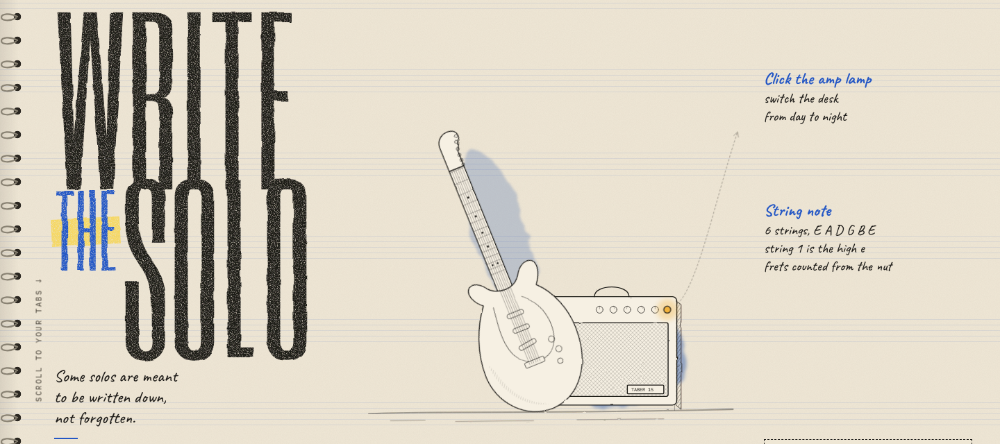
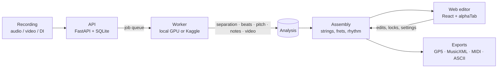

<div align="center">

# HBA Guitar Taber

**Turn a recorded guitar solo into an editable tab: strings, frets, rhythm and techniques.**

[Download](#download) • [What it does](#what-it-does) • [What it can't do yet](#what-it-cant-do-yet) • [Report a problem](#report-a-problem) • [Support Taber](#support-taber) • [For developers](#for-developers)



</div>

> [!IMPORTANT]
> **Free to use, not open source.** Anyone may download the app and use it for non-commercial purposes, and the tabs
> you make with it are yours (even to sell). Commercial use of the app, redistributing it, publishing modified
> versions, and copying its code, design or models into another product are not allowed without written permission
> from Ha Van Thien Bao. See [LICENSE](LICENSE) ([tóm tắt tiếng Việt](LICENSE.vi.md)).

**Tiếng Việt:** trang tải có bản tiếng Việt, bấm **VI** ở góc trên:
https://habaodunggithub.github.io/HBAGuitarTaber/

## Download

**Get it from the download page: https://habaodunggithub.github.io/HBAGuitarTaber/**

| System | What you need | Download |
|---|---|---|
| Windows | Windows 10 or 11, 64-bit | installer `.exe` |
| macOS | Apple Silicon (M1 or newer), macOS 14 or newer | disk image `.dmg` |
| Linux | x86-64, Ubuntu 22.04 or newer (glibc 2.35+) | `.deb` (Debian, Ubuntu) or AppImage |

Intel Macs are not supported. Older versions and release notes are on
[GitHub Releases](https://github.com/habaodunggithub/HBAGuitarTaber/releases). Each release also lists
`SHA256SUMS.txt`, a fingerprint of every file: if the one you downloaded matches, it is exactly the file
that was published.
<!-- Link each release's VirusTotal scan here once desktop.yml adds it to the release notes. -->

**The first time you open it**, Taber is not code-signed yet, so your system asks once whether you trust it:

- **Windows**: SmartScreen says "Windows protected your PC". Choose **More info**, then **Run anyway**.
  If **Smart App Control** is on, Windows blocks unsigned apps with no way around it, and you have to turn it
  off in Windows Security to use Taber.
- **macOS**: open the app once and choose **Done** when macOS refuses it. Then open
  **System Settings → Privacy & Security**, scroll down, choose **Open Anyway** and enter your password.
  The button only shows for about an hour after the first try.
- **Linux**: double-click the `.deb` to install it (App Center warns that it is "potentially unsafe"). The
  AppImage works too: make it executable (`chmod +x`); on Ubuntu 24.04 it also needs `libfuse2t64`.

Taber then installs its **analysis engine** once. It suggests the one that fits your computer:

| Engine | Download | Best for |
|---|---|---|
| NVIDIA GPU | 3–4 GB | Windows or Linux with an NVIDIA card (driver 580 or newer). Fastest. |
| Processor | 0.6 GB | Any computer. The same tabs, slower. |
| Lite | 0.3 GB | Low disk space. A lighter pitch tracker and no backing-track removal. |

**Your recordings and tabs stay on your computer.** Nothing you play is uploaded. Taber only goes online to
download the engine and the models it listens with (once, the first time they are needed), and once a day to
ask GitHub whether a newer version exists. That check sends nothing about you or your recordings.

## What it does

1. **Play the solo.** Any recording works: wav, mp3, m4a and other audio, or a video from your phone. If you
   recorded a clean DI signal too, add it.
2. **Drop it in.** Taber listens and writes the tab: which string and fret each note was played on, the rhythm,
   and bends, vibrato, slides and whammy.
3. **Fix what it got wrong.** The editor plays along with your recording. Move a note to another string, change
   its pitch, delete it or add one it missed. Undo, redo, and earlier versions are all kept.
4. **Practise and export.** Hear the guitar alone, or the band without the guitar to play along with. Change
   capo, tuning or tempo instantly. Export to Guitar Pro (`.gp5`), MusicXML, MIDI or ASCII tab.

A solo recorded over a backing track works too: Taber separates the guitar from the band first (not with the
Lite engine). With a phone video, mark four points on the neck once and Taber watches your fretting hand to
pick the right string. Both are new: so far they have been tested on acoustic guitar and generated videos,
not yet on real electric takes or real phone videos.

## What it can't do yet

Measured on recordings it had never heard before, not promised:

- **Electric guitar is the hard case.** On electric licks, 39% of the notes come out fully right (pitch,
  string and fret), and 26% of the notes are missed, mostly ones that ring into the next note. On
  acoustic guitar it is 77%. Expect to fix an electric solo by hand.
- **Hammer-ons and pull-offs are not detected yet.** They sound too much like picked notes. Add them in the
  editor.
- **Solos only, one note at a time.** Chords are not written out properly yet.
- **Playback plays your recording**, not a synthesized version of the tab.

## Report a problem

Something broken, or a tab that came out badly wrong? Tell us, so the next version gets it right:

- **With a GitHub account**: [open an issue](https://github.com/habaodunggithub/HBAGuitarTaber/issues/new).
  <!-- Link the bug-report and wrong-result issue templates here once they exist. -->
- **Without one**: a short form is coming with version 1.0.
  <!-- Link the Google Form here once it exists. -->

Say which system you use, which engine you picked, and what you did just before it went wrong.
<!-- Explain the diagnostics bundle and the "Report a wrong result" button here once they ship. -->

## Support Taber

Taber is free. If it saved you some hours of writing out solos by ear, you can support it with a bank
transfer inside Vietnam (VietQR). The QR code will be here with version 1.0.
<!-- Put the VietQR image and account name here, and the same link in .github/FUNDING.yml when it is added. -->

## For developers

Everything below is for people who want to run Taber from source, use the command line or work on the code.
None of it is needed to use the app.

### Under the hood

- **Audio to tab**: pitch tracking (PESTO), learned note onsets (Basic Pitch), a string classifier that
  hears which string a note was played on, string/fret assignment (Viterbi over playable fingerings) and
  rhythm quantization (Beat This!), measured on real acoustic (GuitarSet) and electric (IDMT) guitar.
- **Backing track removal**: when the take has a band behind the guitar, the guitar stem is separated with
  Demucs before note detection. The editor's player can then switch between the original, the guitar
  alone and the backing alone (to play along).
- **Video assist**: calibrate four points on the neck in one video frame, and the fretting hand
  (MediaPipe) helps decide the string and fret of each note.
- **Browser editor**: a play-along lane and a full score (alphaTab) that follow the audio; move a note to
  another string, change its pitch, delete it or add a missed one; locks, undo/redo, autosave, versions.
- **Your own test set**: mark a tab you have checked, and `just truth-eval` re-transcribes every checked
  take and shows where the app still goes wrong (missed notes, extra notes, wrong pitch, wrong string).
- **Instant re-assembly**: change capo, tuning, tempo or fingering preferences, or tap the beat yourself,
  without re-running the models; locked notes stay put.
- **Exports**: Guitar Pro (`.gp5`), MusicXML, MIDI, ASCII tab and alphaTex.
- **Run it where the GPU is**: a pull worker on your own machine, or on Kaggle (2× T4) for batches.

### Prerequisites

- [uv](https://docs.astral.sh/uv/) (Python 3.12 is installed by `uv` itself)
- [Node.js](https://nodejs.org/) with [pnpm](https://pnpm.io/)
- [FFmpeg](https://ffmpeg.org/) (`ffmpeg` and `ffprobe` on your `PATH`)
- [just](https://just.systems/), the task runner: `uv tool install rust-just`
- Optional: an NVIDIA GPU with CUDA, for faster analysis

### Run the app from source

```bash
just setup     # Python deps (CUDA torch), web deps, Chromium for the tests
just app       # builds the web app and serves UI + API on http://127.0.0.1:8000
just worker    # in a second terminal: the analysis worker (GPU if available)
```

Open http://127.0.0.1:8000, drop a recording, wait for the worker to finish, then edit the tab.

> [!TIP]
> No GPU, or short on disk space? `just setup-cpu` installs everything without torch and uses the lighter
> pYIN pitch tracker.

Building the desktop app yourself: [apps/desktop/README.md](apps/desktop/README.md).

### Command line only

```bash
just transcribe solo.wav out/ --di solo.di.wav --capo 2       # -> out/solo.gp5, .txt, .mid, .musicxml, .alphatex
uv run taber assemble out/analysis.json.gz -o out2 --tuning drop_d   # re-assemble instantly, no models
```

### Analyse on Kaggle

The `kaggle/` folder holds a batch notebook (one worker per GPU) and a pull worker that serves the web app's
queue from Kaggle. Setup and commands are in [kaggle/README.md](kaggle/README.md).

### How it works



The expensive part (the models) runs once per recording and is cached by content. Everything after it,
assembling the tab from the analysis, is fast and runs on the server whenever you change a setting, so the
editor never waits for a GPU. Design decisions and their measurements are recorded in
[docs/ARCHITECTURE.md](docs/ARCHITECTURE.md).

### Project layout

| Path | What it holds |
|---|---|
| `packages/taber_ir` | Lightweight core, no torch: score schema, string/fret assignment, rhythm quantization, exporters |
| `packages/taber_ml` | Models and pipeline: separation, pitch tracking, segmentation, techniques, video, CLI, worker |
| `services/api` | FastAPI + SQLite: uploads, job queue (lease / heartbeat), live progress (SSE), revisions, exports |
| `apps/web` | React + Vite app: play-along lane, alphaTab score, editor, Playwright end-to-end tests |
| `apps/desktop` | Electron shell: installs the Python runtime on first launch, runs the API + worker, opens the editor |
| `site/` | The download page (GitHub Pages) |
| `kaggle/` | Kaggle notebooks and metadata (environment check, batch, pull worker) |
| `ml/eval` | Ground-truth licks, GuitarSet evaluation and tuning studies |

### Tests

```bash
just test        # everything: Python (pytest), web (tsc + vitest), end-to-end (Playwright, real API + worker)
just test-py     # or one part at a time
just test-web
just test-e2e
just eval        # accuracy metrics on the synthetic licks (or: just eval path/to/your/takes)
just truth-eval  # accuracy on the tabs you checked in the editor (data/truth)
```

### Accuracy in detail

- **Electric guitar**: on unseen electric licks (IDMT-SMT-Guitar), 39% of the played notes come out fully
  right (pitch, string and fret; it was 22% before pipeline 0.2), with 26% of notes missed, mostly notes that
  ring over the next one. On an acoustic held-out player (GuitarSet) it is 77%. Adding a video lets the
  fretting hand decide; this is tested on synthetic video only so far.
- **Hammer-ons and pull-offs** are not detected from audio by default: a threshold cannot separate them from
  picked notes reliably, and a classifier trained on real takes is still needed.
- **Backing track separation** raised note F1 from 0.62 to 0.85 (band at the guitar's level) on GuitarSet
  with a synthetic band. GuitarSet is acoustic guitar; real electric takes are still untested.
- **Monophonic solos only.** Chords are grouped but not tuned, and playback uses the original audio rather
  than synthesizing the tab.

> [!NOTE]
> Third-party libraries, fonts and sound fonts keep their own licenses. The inventory is in
> [THIRD_PARTY_LICENSES.md](THIRD_PARTY_LICENSES.md).
