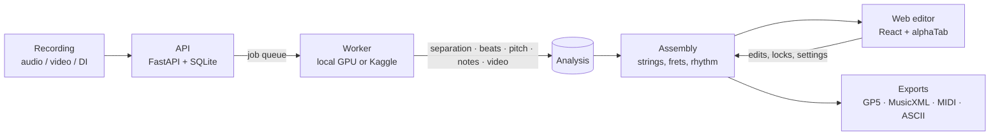

<div align="center">

# HBA Guitar Taber

**Turn a recorded guitar solo into an editable tab: strings, frets, rhythm and techniques.**

[Features](#features) • [Getting started](#getting-started) • [How it works](#how-it-works) • [Project layout](#project-layout) • [Known limits](#known-limits)


</div>

> [!IMPORTANT]
> This project is **not open source**. The code is published for reference only: using, copying, modifying or
> redistributing it requires written permission from the author, and permitted uses must credit
> Ha Van Thien Bao. See [LICENSE](LICENSE).

Drop a recording of a solo (audio or a phone video, optionally with the clean DI take) and Taber writes the tab:
which string and fret each note was played on, the rhythm on a beat grid, and techniques such as bends,
vibrato, slides and whammy. You then fix what it got wrong in the browser, play the tab back in sync with the
original take, and export it to Guitar Pro, MusicXML, MIDI or ASCII.

## Features

- **Audio to tab**: pitch tracking, note segmentation, string/fret assignment (Viterbi over playable
  fingerings) and rhythm quantization, tuned on real guitar recordings (GuitarSet).
- **Backing track removal**: when the take has a band behind the guitar, the guitar stem is separated with
  Demucs before note detection.
- **Video assist**: calibrate four points on the neck in one video frame, and the fretting hand
  (MediaPipe) helps decide the string and fret of each note.
- **Browser editor**: a play-along lane and a full score (alphaTab) that follow the audio, note-by-note
  editing with locks, undo/redo, autosave and version history.
- **Instant re-assembly**: change capo, tuning, tempo or fingering preferences, or tap the beat yourself,
  without re-running the models; locked notes stay put.
- **Exports**: Guitar Pro (`.gp5`), MusicXML, MIDI, ASCII tab and alphaTex.
- **Run it where the GPU is**: a pull worker on your own machine, or on Kaggle (2× T4) for batches.

## Getting started

### Prerequisites

- [uv](https://docs.astral.sh/uv/) (Python 3.12 is installed by `uv` itself)
- [Node.js](https://nodejs.org/) with [pnpm](https://pnpm.io/)
- [FFmpeg](https://ffmpeg.org/) (`ffmpeg` and `ffprobe` on your `PATH`)
- [just](https://just.systems/), the task runner: `uv tool install rust-just`
- Optional: an NVIDIA GPU with CUDA, for faster analysis

### Run the app

```bash
just setup     # Python deps (CUDA torch), web deps, Chromium for the tests
just app       # builds the web app and serves UI + API on http://127.0.0.1:8000
just worker    # in a second terminal: the analysis worker (GPU if available)
```

Open http://127.0.0.1:8000, drop a recording, wait for the worker to finish, then edit the tab.

> [!TIP]
> No GPU, or short on disk space? `just setup-cpu` installs everything without torch and uses the lighter
> pYIN pitch tracker.

### Command line only

```bash
just transcribe solo.wav out/ --di solo.di.wav --capo 2       # -> out/solo.gp5, .txt, .mid, .musicxml, .alphatex
uv run taber assemble out/analysis.json.gz -o out2 --tuning drop_d   # re-assemble instantly, no models
```

### Analyse on Kaggle

The `kaggle/` folder holds a batch notebook (one worker per GPU) and a pull worker that serves the web app's
queue from Kaggle. Setup and commands are in [kaggle/README.md](kaggle/README.md).

## How it works



The expensive part (the models) runs once per recording and is cached by content. Everything after it,
assembling the tab from the analysis, is fast and runs on the server whenever you change a setting, so the
editor never waits for a GPU. Design decisions and their measurements are recorded in
[docs/ARCHITECTURE.md](docs/ARCHITECTURE.md).

## Project layout

| Path | What it holds |
|---|---|
| `packages/taber_ir` | Lightweight core, no torch: score schema, string/fret assignment, rhythm quantization, exporters |
| `packages/taber_ml` | Models and pipeline: separation, pitch tracking, segmentation, techniques, video, CLI, worker |
| `services/api` | FastAPI + SQLite: uploads, job queue (lease / heartbeat), live progress (SSE), revisions, exports |
| `apps/web` | React + Vite app: play-along lane, alphaTab score, editor, Playwright end-to-end tests |
| `kaggle/` | Kaggle notebooks and metadata (environment check, batch, pull worker) |
| `ml/eval` | Ground-truth licks, GuitarSet evaluation and tuning studies |

## Tests

```bash
just test        # everything: Python (pytest), web (tsc + vitest), end-to-end (Playwright, real API + worker)
just test-py     # or one part at a time
just test-web
just test-e2e
just eval        # accuracy metrics on the synthetic licks (or: just eval path/to/your/takes)
```

## Known limits

- **String/fret choice from audio alone is ambiguous.** On held-out GuitarSet players, 64% of detected notes
  get the exact string and fret the player used. Adding a video lets the fretting hand decide; this is tested
  on synthetic video only so far.
- **Hammer-ons and pull-offs** are not detected from audio by default: a threshold cannot separate them from
  picked notes reliably, and a classifier trained on real takes is still needed.
- **Backing track separation** raised note F1 from 0.62 to 0.85 (band at the guitar's level) on GuitarSet
  with a synthetic band. GuitarSet is acoustic guitar; real electric takes are still untested.
- **Monophonic solos only.** Chords are grouped but not tuned, and playback uses the original audio rather
  than synthesizing the tab.

> [!NOTE]
> Third-party libraries, fonts and sound fonts keep their own licenses. The inventory is in
> [THIRD_PARTY_LICENSES.md](THIRD_PARTY_LICENSES.md).
