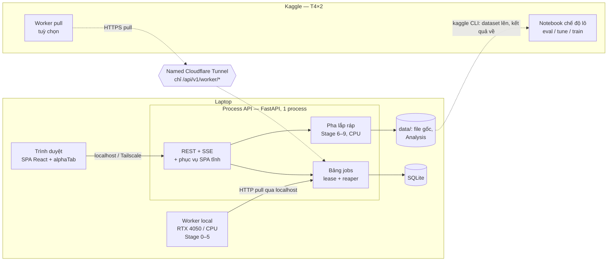
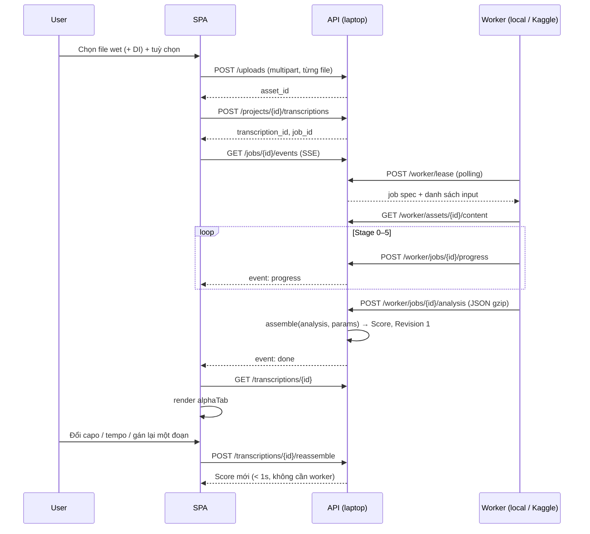
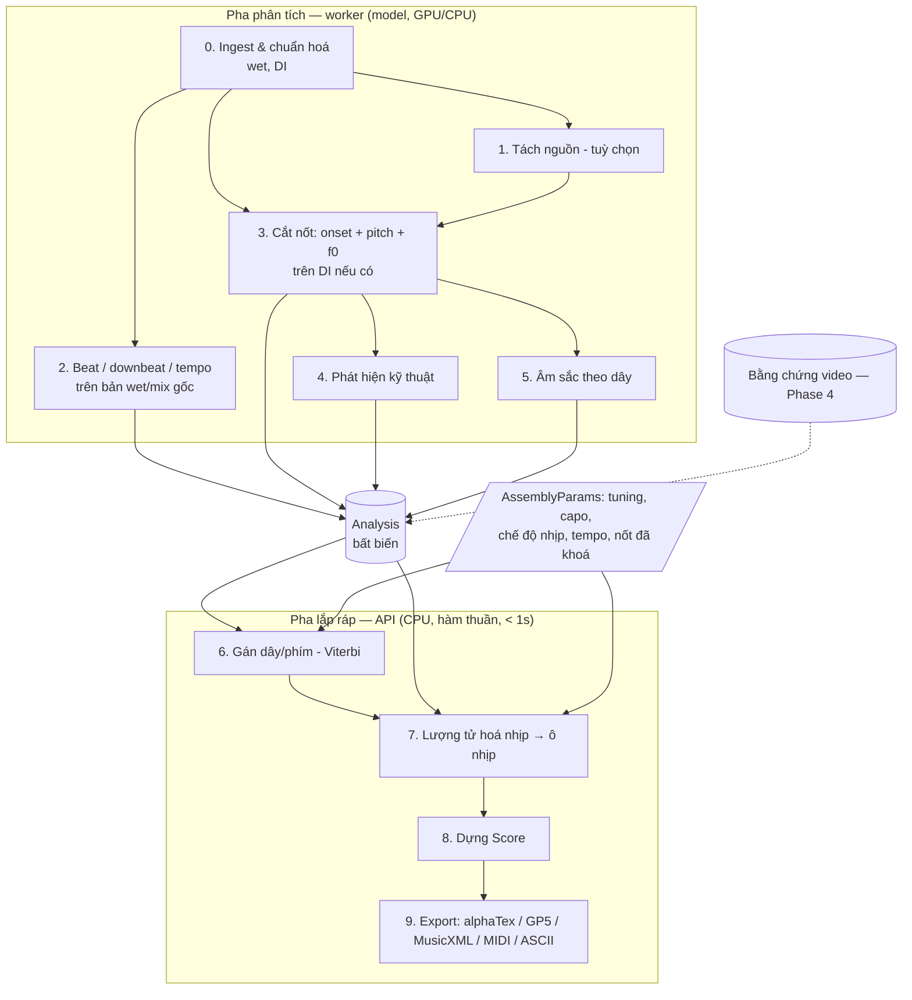
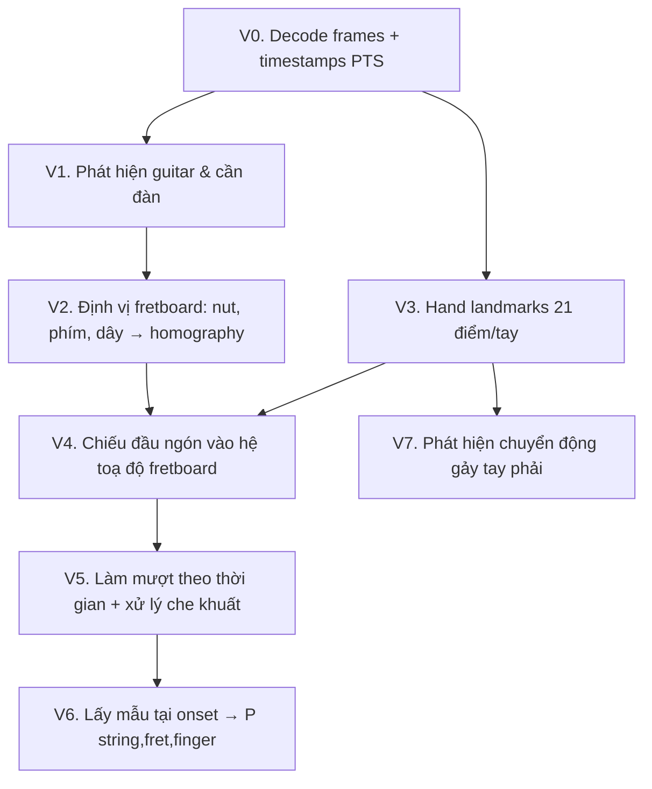
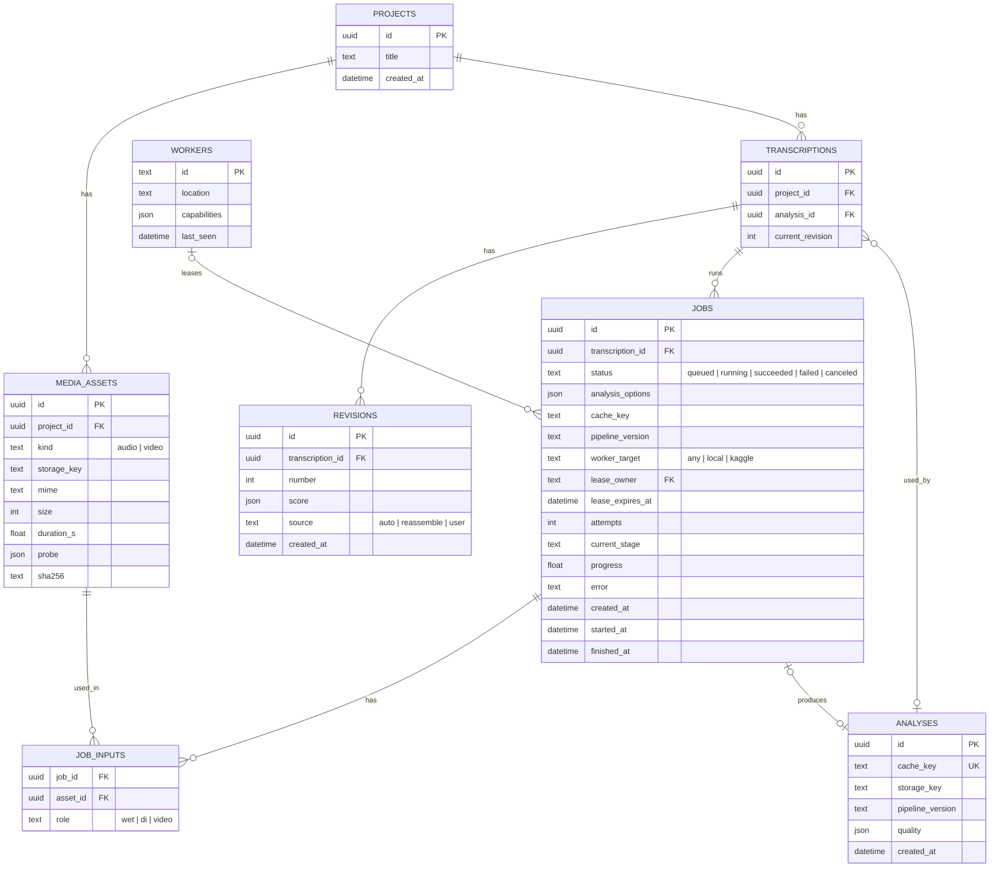

# HBAGuitarTaber — Tài liệu Thiết kế & Kiến trúc

> **Mục tiêu:** Web app nhận **audio** (hoặc **video**) tiếng guitar solo và sinh ra **guitar tab** (dây/phím, nhịp, kỹ thuật). Khi có video, hệ thống phân tích **thế tay trái, vị trí ngón bấm, vị trí trên cần đàn** để chọn đúng dây/phím (vì cùng một nốt có thể bấm ở 2–5 vị trí khác nhau).
>
> **Trạng thái:** Proposed (rev 2, đã áp dụng review kiến trúc) · **Ngày:** 2026-11-07 · **Người quyết định:** HABAO

---

## 0. Bối cảnh & quyết định đã chốt

*(cập nhật 2026-11-07)*

| Câu hỏi | Trả lời | Hệ quả thiết kế |
|---|---|---|
| Cá nhân hay công khai? | Dùng cá nhân trước, ổn mới public | Chưa làm auth/multi-user; **SQLite + thư mục `data/`**; UI chỉ mở qua localhost/Tailscale; tạm chấp nhận lib/weights phi thương mại nhưng đánh dấu để thay trước khi public (ADR-008) |
| Phần cứng | Laptop RTX 4050 6GB; muốn dùng Kaggle T4×2 | Inference mặc định chạy **trên laptop**; Kaggle dùng **chế độ lô** cho eval/tune/train/Demucs; worker Kaggle chạy liên tục là tuỳ chọn, chỉ dựng khi số đo cho thấy cần (ADR-007) |
| Loại âm thanh | **Guitar điện, distortion nhẹ** (đàn dáng Strat có cần tremolo trong video mẫu) | Đo hai cách cắt nốt (Basic Pitch và f0-first); lọc nốt ma do méo tiếng; augmentation bằng amp sim; **khuyến nghị thu kèm track DI**; thêm kỹ thuật **whammy bar** |
| Góc quay | Điện thoại dọc, chính diện hơi chếch, cần đàn nằm ngang sang phải | Ghi chú cho Phase video ở mục 5.4 |
| Làm gì trước | **Chỉ audio**; ổn rồi mới thêm video | Phase 0–3 = audio. Video = Phase 4; hiện chỉ giữ chỗ `video_evidence` trong `Analysis` |

### Thay đổi ở rev 2 (sau review kiến trúc)
1. **Pipeline tách 2 pha** (ADR-009). Pha *phân tích* (Stage 0–5, cần model/GPU) sinh một file `Analysis` nhỏ. Pha *lắp ráp* (Stage 6–9: gán dây/phím, lượng tử hoá, dựng bản nhạc, xuất file) là hàm thuần chạy CPU ngay trong API. Nhờ vậy đổi tuning/capo/tempo hay gán lại dây/phím một đoạn cho kết quả tức thì, không cần GPU.
2. **Một lõi worker `run_analysis(spec, io)`**. `JobIO` có nhiều bản cài đặt: thư mục local (CLI, Kaggle batch), HTTP pull, và dispatcher Modal khi public.
3. **Bảo mật:** UI không đi qua tunnel (dùng localhost/Tailscale). Nếu dựng worker Kaggle thì chỉ dùng named tunnel và chỉ expose `/api/v1/worker/*`.
4. **Kaggle:** ưu tiên chế độ lô. Worker pull từ xa là tuỳ chọn, và phải tự thoát khi rảnh để không tiêu quota.
5. **Tách package:** `taber_ir` (nhẹ, không torch) và `taber_ml` (chứa model).
6. **Sửa IR:** `Analysis` (bất biến) tách khỏi `Score` (người dùng sửa); một quy ước dây duy nhất; bỏ `Fraction`; đổi tên `Beat` thành `Slot`.
7. **Schema:** thêm `JOB_INPUTS` (role wet/di/video), `ANALYSES`, `WORKERS`; bỏ `JOB_STAGES` và `USERS` (thêm lại khi public).
8. **Frontend:** Vite SPA do FastAPI phục vụ, thay cho Next.js (ADR-010).
9. **Editor cơ bản đưa lên Phase 2**; thêm các chế độ nhịp (`auto / grid_from_hint / user_tapped / free`).

---

## Mục lục

0. [Bối cảnh & quyết định đã chốt](#0-bối-cảnh--quyết-định-đã-chốt)
1. [Bài toán & phạm vi](#1-bài-toán--phạm-vi)
2. [Yêu cầu](#2-yêu-cầu)
3. [Kiến trúc tổng thể](#3-kiến-trúc-tổng-thể)
4. [Pipeline xử lý audio → tab](#4-pipeline-xử-lý-audio--tab)
5. [Pipeline xử lý video (thế tay, ngón bấm)](#5-pipeline-xử-lý-video-thế-tay-ngón-bấm)
6. [Hợp nhất audio + video: chọn dây/phím](#6-hợp-nhất-audio--video-chọn-dâyphím)
7. [Định dạng dữ liệu trung gian (IR)](#7-định-dạng-dữ-liệu-trung-gian-ir)
8. [Backend: API, job queue, lưu trữ, CSDL](#8-backend-api-job-queue-lưu-trữ-csdl)
9. [Frontend](#9-frontend)
10. [Công nghệ & thư viện (tổng hợp)](#10-công-nghệ--thư-viện-tổng-hợp)
11. [Cấu trúc repo](#11-cấu-trúc-repo)
12. [ML: dữ liệu, huấn luyện, đánh giá](#12-ml-dữ-liệu-huấn-luyện-đánh-giá)
13. [Hạ tầng, triển khai, chi phí](#13-hạ-tầng-triển-khai-chi-phí)
14. [Kiểm thử & chất lượng](#14-kiểm-thử--chất-lượng)
15. [Bảo mật, bản quyền, giấy phép](#15-bảo-mật-bản-quyền-giấy-phép)
16. [Architecture Decision Records](#16-architecture-decision-records)
17. [Lộ trình triển khai](#17-lộ-trình-triển-khai)
18. [Rủi ro & câu hỏi mở](#18-rủi-ro--câu-hỏi-mở)

---

## 1. Bài toán & phạm vi

### 1.1 Vì sao bài toán khó

| Khó khăn | Giải thích | Hướng xử lý |
|---|---|---|
| **Nhập nhằng dây/phím** | Nốt E4 (MIDI 64) có thể là dây 1 phím 0, dây 2 phím 5, dây 3 phím 9, dây 4 phím 14, dây 5 phím 19. Audio thuần chỉ cho cao độ. | Thuật toán tối ưu ngón (Viterbi) + đặc trưng âm sắc từng dây + **bằng chứng từ video**. |
| **Kỹ thuật biểu diễn** | Bend, slide, hammer-on, pull-off, vibrato, palm mute, harmonic… làm cao độ “trượt” và onset yếu. | Phân tích đường cao độ liên tục (f0 contour) + bộ phân loại kỹ thuật. |
| **Nhịp điệu** | Người chơi rubato, không theo metronome; cần ra ô nhịp, trường độ (1/16, chùm 3…). | Beat tracking → lưới phách → lượng tử hoá bằng quy hoạch động. |
| **Âm thanh bẩn** | Distortion, reverb, delay, có backing track, nhiều nhạc cụ. | Tách nguồn (source separation) trước khi phiên âm. |
| **Video không chuẩn** | Góc quay khác nhau, ngón bị che, cần đàn chuyển động, mờ do chuyển động. | Phát hiện cần đàn + homography + làm mượt theo thời gian; video chỉ là **bằng chứng phụ** (xác suất), không phải nguồn sự thật duy nhất. |

### 1.2 Phạm vi

**Trong phạm vi (In scope)**
- Guitar 6 dây (điện/acoustic), chủ yếu **đơn âm (monophonic) solo**, cho phép double-stop/hợp âm ngắn ở bản sau.
- Tuning chuẩn E A D G B E, có tuỳ chọn tuning khác (Drop D, Eb…) và capo.
- **Ưu tiên số 1:** guitar điện, distortion nhẹ, solo đơn âm.
- Input: audio (`wav, mp3, flac, m4a, ogg`), tuỳ chọn kèm track **DI** cùng đoạn. Video (`mp4, mov, webm`) từ Phase 4.
- Output: tab hiển thị trên web + phát lại đồng bộ, chỉnh sửa, xuất **Guitar Pro (.gp5)**, **MusicXML**, **MIDI**, **ASCII tab**, **PDF**.

**Ngoài phạm vi (bản đầu)**
- Bass, guitar 7–8 dây (thiết kế để mở rộng sau qua cấu hình tuning).
- Phiên âm hợp âm rải phức tạp / fingerstyle đa bè (Phase 6).
- Realtime (phiên âm trực tiếp khi đang chơi).

---

## 2. Yêu cầu

### 2.1 Yêu cầu chức năng

| ID | Yêu cầu | Ưu tiên |
|---|---|---|
| F1 | Upload audio, nhận tab | P0 |
| F2 | Hiển thị tab + bản nhạc, phát lại đồng bộ con trỏ với audio gốc | P0 |
| F3 | Chọn tuning, capo, tempo gợi ý (tuỳ chọn) | P0 |
| F4 | Xuất GP5 / MusicXML / MIDI / ASCII | P0 |
| F5 | Tách guitar khỏi bản mix (khi có backing track) | P1 |
| F6 | Phát hiện kỹ thuật: bend, slide, H/P, vibrato, palm mute | P1 |
| F7 | Chỉnh sửa tab trên web. **Bản cơ bản ở Phase 2:** đổi cách bấm ↑/↓, khoá nốt, sửa nhịp, gán lại dây/phím một đoạn. Bản đầy đủ (kỹ thuật, tách/gộp nốt) ở Phase 3. Lưu phiên bản | P0 |
| F8 | Upload video, phân tích thế tay để cải thiện dây/phím, hiển thị ngón (1-2-3-4) | Phase 4 |
| F9 | Chế độ học: overlay video + fretboard ảo + tab chạy, slow-down, loop | P2 |
| F10 | Tài khoản người dùng, thư viện dự án | P2 |
| F11 | Thu thập chỉnh sửa của người dùng làm dữ liệu huấn luyện (có đồng ý) | P2 |

### 2.2 Yêu cầu phi chức năng

| Hạng mục | Mục tiêu |
|---|---|
| Thời gian xử lý | Audio 3 phút: < 60s trên 1 GPU T4 hoặc RTX 4050 (chưa tính thời gian khởi động notebook Kaggle), < 5 phút trên CPU. Video 3 phút 1080p (Phase 4): < 3 phút trên T4. |
| Giới hạn input | Audio ≤ 50 MB / ≤ 10 phút; Video ≤ 1 GB / ≤ 10 phút. Upload từ trình duyệt đi thẳng vào API (localhost/Tailscale), **không** qua Cloudflare Tunnel. Mọi request đi qua tunnel (kết quả của worker từ xa) phải < 100 MB, vì đó là giới hạn body của Cloudflare gói free *(kiểm tra lại)*. |
| Độ chính xác (mục tiêu MVP) | Note F1 (onset ±50ms, pitch đúng) ≥ 0.85 trên guitar DI/clean solo; Tab accuracy (đúng dây+phím) ≥ 0.75 audio-only, ≥ 0.90 khi có video. *Đây là giả thuyết: đo baseline ở Phase 1 rồi chốt lại.* |
| UX | Hiển thị tiến độ từng bước (SSE). Đổi tuning/capo/tempo hoặc gán lại dây/phím: < 1s (pha lắp ráp, không cần worker). |
| Khả năng lặp lại | Pha lắp ráp tất định tuyệt đối. Pha phân tích: cùng input + cùng `pipeline_version` + cùng loại thiết bị ⇒ cùng output; giữa các GPU khác nhau (T4, 4050, CPU) chấp nhận sai khác nhỏ ở nốt sát ngưỡng. Ghi `device` vào `Analysis.meta`. |
| Chi phí | 0 đồng ở giai đoạn cá nhân: chạy trên laptop (RTX 4050) hoặc Kaggle (quota GPU miễn phí theo tuần); không dùng API trả phí. |

---

## 3. Kiến trúc tổng thể

### 3.1 Sơ đồ khối

**Giai đoạn cá nhân (hiện tại):**



- **UI không bao giờ đi qua tunnel.** Bạn mở app bằng `http://localhost:8000`, hoặc từ điện thoại qua **Tailscale**. Tunnel chỉ mở ra ngoài đúng các đường dẫn của worker, có `WORKER_TOKEN` bảo vệ, và chỉ cần khi dựng worker Kaggle chạy liên tục.
- **Worker local cũng dùng giao thức pull** (qua localhost). Như vậy chỉ có một đường chạy để test, và thêm worker ở nơi khác chỉ là việc cấu hình.
- **Kaggle chế độ lô** không cần tunnel: đẩy dữ liệu lên làm Kaggle Dataset, chạy notebook bằng `kaggle kernels push`, rồi tải kết quả về (mục 8.6).

**Khi public (Phase 5):** SQLite → PostgreSQL, `data/` → S3/R2, thêm auth. Phần GPU dùng serverless (Modal/RunPod) qua `ModalDispatcher`: API **gọi** function kèm presigned URL thay vì chờ worker pull, để GPU scale về 0. Lõi `run_analysis` giữ nguyên (ADR-009).

### 3.2 Nguyên tắc kiến trúc

1. **Modular monolith + worker tách riêng** (ADR-001). Có một process API (nhẹ, CPU) và worker (nặng, model). Cả hai dùng chung package `taber_ir` (schema, fusion, quantize, export; không phụ thuộc torch). Chỉ worker cài `taber_ml`.
2. **Hai pha** (ADR-009):
   - *Phân tích* (Stage 0–5) chạy trong worker, tốn thời gian, sinh `Analysis` **bất biến**.
   - *Lắp ráp* (Stage 6–9) là hàm thuần `assemble(analysis, params) → Score`, chạy trong API dưới 1 giây, chạy lại bao nhiêu lần cũng được.
3. **Lõi worker không biết mình chạy ở đâu:** `run_analysis(spec, io: JobIO)`. Các adapter `LocalDirIO` (CLI, Kaggle batch), `HttpPullIO` (worker pull) và `ModalIO` (khi public) chỉ lo lấy input, báo tiến độ và nộp kết quả.
4. **IR là hợp đồng duy nhất** giữa các phần (mục 7). Mọi exporter/renderer chỉ đọc `Score`; mọi thuật toán lắp ráp chỉ đọc `Analysis`.
5. **Video là bằng chứng xác suất**, không phải quyết định cứng (Phase 4).
6. **Mọi model nằm sau một interface** (`NoteSegmenter`, `PitchTracker`, `BeatTracker`, `Separator`, sau này `HandTracker`…), nên thay model không phải đổi pipeline.
7. **Phiên bản hoá:** `Analysis.meta` lưu `pipeline_version`, `model_versions`, `device` và tham số. `Score` lưu `assembly_params` và `analysis_id`.

### 3.3 Luồng chính (sequence)



---

## 4. Pipeline xử lý audio → tab

### 4.1 Tổng quan các stage



- **Mỗi stage dùng input nào:**
  - Cắt nốt (Stage 3) dùng **DI** nếu có; không có thì dùng bản wet, hoặc stem đã tách nếu bật tách nguồn.
  - Beat (Stage 2) luôn dùng **bản wet/mix gốc**, vì trống và backing track giúp bắt nhịp.
- Mọi thời điểm trong `Analysis` tính theo **trục thời gian của file wet**, đã cộng lại offset cắt khoảng lặng ở Stage 0.
- Ranh giới giữa hai pha: xem mục 4.3.

### 4.2 Chi tiết từng stage

#### Khuyến nghị đầu vào cho guitar điện (rất đáng làm)
- Bạn đang thu qua laptop/DAW, nên hãy **thu thêm track DI** song song: đó là tín hiệu sạch từ audio interface, lấy trước amp sim/pedal. Pipeline cho phép upload **cặp file**: `di.wav` dùng để phiên âm, còn `wet.wav` (có tone) dùng để nghe và phát lại. Có DI thì độ chính xác tăng rõ rệt, vì distortion tạo thêm hài âm và nốt ma.
- Nếu chỉ có bản có tone: đặt `tone = distortion_light` để bật các bộ lọc ở Stage 3.
- Hai track thu cùng lúc trong DAW thì khớp thời gian sẵn. Nếu không, căn bằng cross-correlation của onset envelope.

#### Stage 0 — Ingest & chuẩn hoá
- **Công cụ:** `ffmpeg` (qua `ffmpeg-python` hoặc subprocess), `soundfile`, `librosa`.
- Việc làm:
  - Nếu là video: tách audio track `ffmpeg -i in.mp4 -vn -ac 1 -ar 44100 audio.wav`; đọc metadata (fps, PTS, rotation).
  - Chuyển mono, resample 44.1 kHz (bản cho tách nguồn) và 22.05/16 kHz (bản cho model pitch tuỳ yêu cầu).
  - Chuẩn hoá loudness (`pyloudnorm`, −23 LUFS), cắt khoảng lặng đầu/cuối nhưng **ghi lại offset** để đồng bộ về thời gian gốc.
  - Kiểm tra: độ dài, sample rate, clipping.
- **Output:** `audio_44k.wav`, `audio_22k.wav` (trong cache worker); `ingest_offset_s` và metadata ghi vào `Analysis`.

#### Stage 1 — Tách nguồn (Source separation) — tuỳ chọn
- Khi người dùng chọn “Có backing track/mix” hoặc auto-detect (tỉ lệ năng lượng ngoài dải guitar cao).
- **Công cụ:** **Demucs `htdemucs_6s`** (có stem `guitar`, MIT license). Phương án thay thế: model BS-RoFormer/MelBand-RoFormer qua `audio-separator` (chất lượng cao hơn cho vocal/instrument, cân nhắc license từng checkpoint).
- Lưu ý: tách nguồn tạo artifact → giảm độ chính xác pitch; nếu input là DI/solo sạch thì **bỏ qua** stage này.
- **Output:** `guitar_stem.wav` (chỉ trong cache worker).

#### Stage 2 — Phân tích nhịp
- **Mục tiêu:** vị trí beat, downbeat, tempo map, số chỉ nhịp (time signature).
- **Input:** bản wet/mix gốc (không dùng DI hay stem đã tách), vì trống và backing track giúp bắt nhịp.
- **Công cụ (theo thứ tự ưu tiên):**
  - **Beat This!** (CPJKU, 2024) — beat/downbeat tracking SOTA, không cần DBN post-processing.
  - `madmom` (RNN + DBN) — cổ điển, ổn định; lưu ý tương thích Python mới và model weights giấy phép phi thương mại.
  - `librosa.beat.beat_track` — fallback nhẹ.
- Cho phép người dùng nhập tempo/time signature ⇒ dùng làm prior hoặc override.
- Với solo đơn lẻ (không có trống) beat tracking kém ⇒ ưu tiên: (a) tempo người dùng nhập, (b) phân tích trên bản mix gốc trước khi tách nguồn (trống giúp bắt nhịp), (c) inter-onset-interval histogram.
- **Output:** `Analysis.beat_grid`. Lưới beat này chỉ là gợi ý: pha lắp ráp có thể thay bằng lưới dựng từ tempo người dùng nhập hoặc gõ tap (Stage 7).

#### Stage 3 — Phiên âm nốt (Note transcription)
Đây là lõi. Đặt sau interface **`NoteSegmenter`** với 2 bản cài đặt; **đo cả hai ở Phase 1** trên bộ test riêng rồi chọn mặc định:
- **`BasicPitchSegmenter`:** Basic Pitch sinh nốt, f0 làm trọng tài để lọc nốt ma (quy trình bên dưới).
- **`F0FirstSegmenter`:** chỉ dành cho chế độ đơn âm. Cắt nốt trực tiếp từ đường f0 (PESTO/CREPE) kết hợp onset: tách nốt tại onset mạnh, hoặc khi f0 nhảy ≥ 1 semitone và giữ ổn định > 40ms. Cách này không sinh nốt ma do hài âm ngay từ đầu, nên có thể tốt hơn với distortion.

Các thành phần dùng chung:

| Thành phần | Công cụ đề xuất | Vai trò |
|---|---|---|
| Phiên âm nốt (note events) | **Spotify Basic Pitch** (Apache-2.0). Chạy bằng **ONNX Runtime** trên CPU thay vì TensorFlow, để tránh xung đột với PyTorch/CUDA *(kiểm tra extra của phiên bản hiện hành)* | Dùng trong `BasicPitchSegmenter`: nốt rời rạc (onset, offset, pitch, velocity), hỗ trợ đa âm nhẹ. |
| Đường cao độ liên tục (f0) | **torchcrepe** (CREPE) hoặc **PESTO** (nhẹ, nhanh), fallback `librosa.pyin` | f0 theo frame (10ms) + voicing confidence ⇒ phát hiện bend/vibrato/slide, tinh chỉnh pitch. |
| Onset | `librosa.onset` (spectral flux), hoặc onset head của model | Phân biệt picked note vs legato (H/P). |
| (Nâng cao) Model chuyên guitar | Fine-tune một model kiểu **TabCNN / FretNet** (dự đoán trực tiếp dây+phím từ CQT) trên GuitarSet/SynthTab | Cho xác suất dây/phím từ audio (Phase 6). |

Quy trình của `BasicPitchSegmenter`:
1. Chạy Basic Pitch → danh sách nốt thô.
2. Chạy f0 tracker → `f0[t]`, `confidence[t]`.
3. **Hậu xử lý** (rule-based, có tham số):
   - Gộp nốt bị cắt vụn (cùng pitch, khoảng hở < 30ms, không có onset mạnh).
   - Bỏ nốt ma (ghost) do harmonic: nốt cách octave/quãng 12 cung với nốt mạnh hơn, trùng thời gian, velocity thấp.
   - **Riêng với distortion:** Basic Pitch hay sinh nốt ma ở quãng 8, quãng 5, quãng 12, do hài âm và méo xuyên điều chế. Ở chế độ đơn âm, **f0 tracker làm trọng tài**: chỉ giữ nốt có pitch khớp f0 trong ±50 cents. Ngoài ra nâng ngưỡng onset/frame của Basic Pitch và tune các ngưỡng này trên bộ bài thu của chính bạn. Sustain dài (do compression/gain) dễ làm offset kéo dài, nên cắt offset tại onset kế tiếp.
   - Với chế độ **monophonic solo**: tại mỗi thời điểm giữ tối đa 1 nốt (ưu tiên khớp f0), trừ khi người dùng bật “cho phép double-stop”.
   - Tinh chỉnh pitch bằng median f0 trong 30–80ms đầu sau onset (tránh vùng bend).
   - Ước lượng **tuning offset** toàn bài (vd đàn lệch +20 cents hoặc tuning Eb) từ histogram độ lệch cents ⇒ gợi ý tuning.
- **Output:** `Analysis.notes` + `Analysis.f0_preview` (f0 hạ mẫu). Bản f0/onset đầy đủ chỉ giữ trong cache worker.

#### Stage 4 — Phát hiện kỹ thuật (Technique detection)
Dựa trên f0 contour + onset strength + (tuỳ chọn) video.

| Kỹ thuật | Tín hiệu nhận biết | Phương pháp |
|---|---|---|
| **Bend** (½, full, 1½) / release / pre-bend | f0 tăng liên tục ≥ 0.4 semitone trong nốt, không có onset mới | Phân đoạn contour; đo biên độ lớn nhất, làm tròn về ¼, ½, 1, 1½, 2 cung |
| **Vibrato** | Dao động f0 tuần hoàn 4–8 Hz, biên độ 0.1–1 semitone | FFT/autocorrelation trên f0 đã trừ xu hướng |
| **Whammy bar** (cần tremolo: dip, dive, vibrato bằng cần) | f0 **giảm** rồi trở về (bend thì tăng), có thể kéo xuống nhiều semitone; vibrato bằng cần thường đối xứng quanh pitch gốc, còn vibrato ngón chỉ đi lên | Phân tích chiều lệch của contour so với pitch gốc; ghi dạng `whammy` có đường cong (alphaTab/GP hỗ trợ whammy bar) |
| **Slide** (legato / shift / slide in/out) | f0 đi qua nhiều semitone theo bậc thang, nhanh (< 150ms), onset yếu | Phát hiện chuỗi bậc pitch liên tiếp; video: tay trượt dọc cần |
| **Hammer-on / Pull-off** | Pitch mới, **onset năng lượng thấp**, không có tiếng gảy (transient yếu ở dải cao) | Ngưỡng tỉ lệ onset strength; classifier nhỏ (GBM/CNN) train trên IDMT-SMT-Guitar; video: tay phải không gảy |
| **Palm mute** | Decay ngắn, năng lượng dải cao thấp | Classifier trên MFCC/spectral centroid |
| **Natural/Pinch harmonic** | Phổ thuần, pitch không khớp vị trí phím hợp lý, timbre “chuông”/“rít” | Classifier (Phase 6) |
| **Tapping, tremolo picking** | Tapping: onset yếu + nhảy quãng lớn; tremolo: chuỗi onset cùng pitch rất dày | Rule-based (Phase 6) |

- Bắt đầu bằng **rule-based có tham số**, log lại các đặc trưng để sau này train classifier (LightGBM) khi có dữ liệu chỉnh sửa của người dùng.
- **Output:** `NoteEvent.techniques` trong `Analysis`.

#### Stage 5 — Đặc trưng âm sắc theo dây (String timbre)
- Cùng một pitch, dây trầm hơn bấm phím cao có âm sắc “dày/tối” hơn, inharmonicity khác.
- Phase 1: bỏ qua (prior đồng đều).
- Phase 3: model nhỏ (CNN trên CQT patch quanh onset) dự đoán `P(string | audio)`; train trên GuitarSet (có nhãn dây cho từng nốt) + SynthTab.
- **Output:** `NoteEvent.string_probs` (6 phần tử, dây 1→6) trong `Analysis`.

#### Stage 6 — Gán dây/phím (Fusion) → xem mục 6. *(Từ đây là pha lắp ráp, chạy trong API.)*

#### Stage 7 — Lượng tử hoá nhịp
- Input: nốt (onset/offset giây) + beat grid.
- Chuyển thời gian → vị trí phách: nội suy tuyến tính giữa các beat ⇒ `beat_pos` (số thực).
- **Lượng tử hoá bằng DP/HMM**: trạng thái = lưới chia nhỏ phách (1/4, 1/8, 1/16, 1/32, chùm 3 của 1/8 và 1/16); chi phí = sai số thời gian + phạt độ phức tạp (ưu tiên 1/16 hơn 1/32, phạt chùm 3 nếu không ổn định). Đây là cách tránh tab đầy nốt 1/64 vô nghĩa.
- Trường độ: offset lượng tử hoá, kẹp tối thiểu = đến nốt kế tiếp (solo đơn âm), thêm dấu lặng ở khoảng trống.
- Chia ô nhịp theo downbeat + time signature; tách nốt vắt qua vạch nhịp bằng dấu nối (tie).
- **Chế độ nhịp** (`AssemblyParams.timing`):
  - `auto`: dùng beat grid của Stage 2.
  - `grid_from_hint`: lưới đều dựng từ tempo người dùng nhập (+ vị trí phách đầu); hợp khi chơi theo metronome hoặc backing track.
  - `user_tapped`: người dùng gõ tap-tempo hoặc kéo vạch beat trên waveform để tạo lưới mới.
  - `free`: chơi rubato. Vẫn lượng tử hoá theo tempo trung bình nhưng nới phạt sai số, và đánh dấu bài là "free time".
  - Vì lượng tử hoá thuộc pha lắp ráp (CPU), đổi chế độ hay sửa lưới beat đều cho kết quả ngay.
- **Output:** các `Slot` (mục 7) có `duration` dạng chuỗi `"1/16"`, `tuplet: [3, 2]`, gom theo ô nhịp.

#### Stage 8 — Dựng Score IR
Gom thành `Score` (mục 7): gắn `ScoreNote` vào `Slot`/`Measure`, sinh `sync_points` theo trục thời gian của file wet.

#### Stage 9 — Export
| Định dạng | Công cụ |
|---|---|
| **alphaTex** (để alphaTab render trên web) | Tự viết serializer (đơn giản, dạng text) |
| **Guitar Pro 5 (.gp5)** | `PyGuitarPro` (Python) |
| **MusicXML** | `music21` hoặc tự sinh XML (có `<technical><string>/<fret>`) |
| **MIDI** | `pretty_midi` / `mido` (gồm pitch bend cho bend/vibrato) |
| **ASCII tab** | Tự viết (dễ, hữu ích để copy-paste) |
| **PDF** | Xuất từ alphaTab ở client (print) hoặc MuseScore CLI ở server từ MusicXML |

### 4.3 Hai pha và file `Analysis` (ADR-009)

**Vì sao tách:** những thao tác bạn lặp lại nhiều nhất chỉ ảnh hưởng Stage 6–9: đổi tuning/capo, chỉnh tempo, kéo lại vạch beat, gán lại dây/phím một đoạn, khoá nốt đã sửa. Các stage này không cần model, nên không có lý do bắt chúng chờ GPU hay Kaggle.

| | Pha phân tích | Pha lắp ráp |
|---|---|---|
| Stage | 0–5 | 6–9 |
| Chạy ở | Worker (`taber_ml`) | Process API, CLI (`taber_ir`) |
| Input | File audio + `AnalysisOptions` | `Analysis` + `AssemblyParams` + nốt đã khoá |
| Output | `Analysis` (JSON gzip, vài trăm KB – vài MB) | `Score` |
| Thời gian | Vài chục giây – vài phút | < 1s cho bài 3–5 phút |
| Tất định | Gần như (sai khác nhỏ giữa các GPU) | Tuyệt đối |
| Chạy lại khi | Đổi file, đổi `AnalysisOptions` (tách nguồn, `tone`, segmenter), nâng `pipeline_version` | Mọi chỉnh sửa còn lại |

**`Analysis` chứa** (định nghĩa ở mục 7):
- danh sách `NoteEvent`: thời gian, cao độ, độ mạnh onset, kỹ thuật, `string_probs`;
- `BeatGrid`;
- `f0_preview`: f0 hạ mẫu ~50 Hz, dùng để vẽ trên UI;
- `QualityReport`;
- `meta`.

**Artifact lớn chỉ nằm trong cache của worker:** f0 đầy đủ 100 Hz, stem đã tách, onset envelope. Cache đánh khoá theo `cache_key` (mục 8.3). Mất cache (vd hết session Kaggle) chỉ làm lần chạy sau chậm hơn, không làm mất chức năng nào.

**Cache kết quả ở API:** nếu đã có `Analysis` cùng `cache_key` thì không tạo job mới mà chuyển thẳng sang lắp ráp.

---

## 5. Pipeline xử lý video (thế tay, ngón bấm)

> ⏸ **Hoãn tới Phase 4.** Phase 0–3 không triển khai mục này. Chỉ cần giữ hai thứ: (1) tham số `P_video` trong hàm fusion (mục 6), mặc định = đồng đều / `conf_v = 0`; (2) trường `NoteEvent.video_evidence` trong `Analysis` và role `video` trong `JOB_INPUTS`. Như vậy lúc thêm video sẽ không phải sửa lại phần audio.

### 5.1 Mục tiêu của video
1. **Vị trí tay trái trên cần đàn** (khoảng phím đang ở — “position”, vd Box 1 ở phím 5) ⇒ ràng buộc mạnh cho chọn dây/phím.
2. **Ngón nào bấm dây nào, phím nào** tại thời điểm onset ⇒ `P(string, fret | video)` và số ngón (1–4) để ghi lên tab.
3. **Chuyển động tay phải (gảy)** ⇒ phân biệt nốt gảy vs legato (H/P), hỗ trợ tremolo.
4. **Chuyển động tay trái dọc cần** ⇒ xác nhận slide.

### 5.2 Các stage video



#### V0 — Decode
- `PyAV` (bindings FFmpeg) hoặc `decord`; đọc **PTS thật** để xử lý video VFR (điện thoại hay quay VFR) ⇒ timestamp mỗi frame theo giây, cùng hệ thời gian với audio tách từ chính video đó ⇒ **đồng bộ miễn phí**.
- Xoay theo metadata rotation; resize về cạnh dài 1280 cho tốc độ; có thể xử lý 30 fps (đủ, vì nốt solo nhanh 16th ở 160 BPM ≈ 94ms ≈ 3 frame).
- Nếu audio và video là **hai file riêng**: đồng bộ bằng cross-correlation giữa onset envelope của 2 audio track (nếu video có tiếng), hoặc người dùng chỉnh offset thủ công trên UI.

#### V1 — Phát hiện guitar / cần đàn
- Model detection/segmentation: **YOLO (Ultralytics) — segment hoặc OBB (oriented bounding box)** cho lớp `guitar_neck`, hoặc **RT-DETR**.
  - ⚠️ Ultralytics là **AGPL-3.0** — nếu public web app thương mại cần license enterprise, hoặc dùng thay thế giấy phép mở hơn: **RT-DETR (Apache-2.0, qua HF transformers)**, **RTMDet (MMDetection, Apache-2.0)**.
- Zero-shot ban đầu (để có data nhanh): **Grounding DINO / OWLv2** với prompt “guitar neck”, **SAM 2** để lấy mask ⇒ dùng làm auto-label rồi fine-tune model nhẹ.
- Tracking giữa frame (ByteTrack hoặc đơn giản là IoU + Kalman) để không phải detect mọi frame.

#### V2 — Định vị fretboard (quan trọng nhất)
Mục tiêu: tìm phép biến đổi **homography H** từ ảnh → hệ toạ độ chuẩn của cần đàn (trục x = khoảng cách từ nut, trục y = vị trí ngang qua 6 dây).

Hai cách (làm cách A trước, cách B khi có data):

- **Cách A — Cổ điển (OpenCV):**
  1. Crop vùng cần đàn, xoay theo trục chính (PCA của mask).
  2. Phát hiện **phím đàn (frets)** = các đường gần vuông góc với trục cần: Canny + Hough lines / LSD (Line Segment Detector).
  3. Phát hiện **dây** = đường gần song song trục cần.
  4. **Fit quy luật phím đàn**: khoảng cách phím thứ n từ nut là `d(n) = L · (1 − 2^(−n/12))` (L = scale length). Dùng **RANSAC** fit `L` và offset vào các đường phím phát hiện được ⇒ robust với phím bị che bởi tay. Đây là mấu chốt để gán đúng chỉ số phím.
  5. Xác định đâu là phía nut / thân đàn (khoảng cách phím giảm dần về phía thân đàn), dùng inlay (chấm phím 3,5,7,9,12) để xác nhận số phím tuyệt đối.
- **Cách B — Học sâu (keypoint):**
  - Train model keypoint (**RTMPose** của MMPose, hoặc YOLO-pose) dự đoán các điểm: 4 góc vùng phím đang thấy + giao điểm phím–dây biên + vị trí inlay.
  - Ổn định hơn với ánh sáng/góc quay khó.
- Làm mượt H theo thời gian (Kalman trên 8 tham số hoặc trên các keypoint), reset khi lỗi reprojection lớn.
- **Output:** `fretboard_track.npz` — mỗi frame: H, confidence, danh sách vị trí phím (x_n), vị trí dây (y_s).

#### V3 — Hand landmarks
- **MediaPipe Hand Landmarker** (Apache-2.0): 21 điểm/tay, có handedness, nhanh cả CPU. Đầu ngón: `4` (cái), `8` (trỏ), `12` (giữa), `16` (áp út), `20` (út).
- Phương án chất lượng cao hơn: **RTMPose / RTMW (MMPose)** whole-body hoặc hand model — tốt hơn khi ngón chồng lên nhau.
- Xác định tay bấm (fretting hand) = tay nằm trong/gần vùng cần đàn; tay gảy = tay gần thân/lỗ thoát âm. Hỗ trợ người chơi tay trái (lefty) bằng cấu hình hoặc tự nhận.
- Làm mượt landmark bằng **One Euro Filter**.

#### V4 — Chiếu đầu ngón vào fretboard
- Với mỗi đầu ngón `p`: `p' = H · p` ⇒ `(x', y')` trong hệ fretboard.
- Phím: tìm n sao cho `x_{n-1} < x' ≤ x_n` (ngón bấm ngay **sau** phím, phía nut), phân phối mềm Gaussian quanh vị trí.
- Dây: dây gần nhất theo y', phân phối mềm.
- Hiệu chỉnh: đầu ngón thật nằm hơi lệch so với landmark (bị che bởi cần khi quay chính diện) ⇒ ước lượng offset từ hướng đốt ngón (DIP→TIP) và học bù từ dữ liệu.
- **Bấm hay không bấm?** Ngón đang “lơ lửng” cũng nằm trên cần. Đặc trưng: độ cong ngón, khoảng cách tới mặt phím (khó trong 2D), sự đứng yên trong vài frame quanh onset. Chiến lược: không quyết định cứng, cho xác suất; fusion với pitch audio sẽ tự loại phần lớn ngón không bấm (vì pitch phải khớp).

#### V5 — Làm mượt & che khuất
- Ngón bị che, motion blur ⇒ confidence thấp ⇒ dùng **position tay** (vị trí ngón trỏ ≈ phím thấp nhất của box) như ràng buộc yếu hơn.
- HMM/Kalman trên “hand position” theo thời gian.

#### V6 — Lấy mẫu tại onset
- Với mỗi nốt audio (onset t): lấy các frame trong cửa sổ `[t − 60ms, t + 40ms]`, tổng hợp ⇒
  - `P_video(string, fret)` cho nốt đó (ma trận 6 × 25),
  - `P_video(finger)` (1–4 + 0 = dây buông),
  - `hand_position(t)` và confidence.

#### V7 — Tay phải (gảy)
- Vận tốc đầu ngón cái/trỏ tay phải (cầm pick) theo trục vuông góc dây; đỉnh vận tốc gần onset ⇒ nốt gảy. Không có ⇒ khả năng legato cao ⇒ đưa vào Stage 4.

### 5.3 Khuyến nghị quay video cho người dùng (hiển thị trên UI)
- Quay **từ phía người chơi nhìn xuống** hoặc **chéo 30–45° từ phía trước**, thấy toàn bộ cần đàn từ nut tới phím 12+.
- Đủ sáng, 60 fps nếu có, khoá phơi sáng, giữ máy cố định.
- Thông báo chất lượng sau phân tích: “% thời gian thấy rõ cần đàn”, “% nốt có bằng chứng video tin cậy”.

### 5.4 Ghi chú cho góc quay của bạn (theo video mẫu)
**Đặc điểm:** điện thoại **dọc 9:16**, đặt cố định, quay chính diện hơi chếch, ngang tầm ngực người chơi. Cần đàn gần nằm ngang, đi từ giữa sang mép phải; đầu cần sát hoặc bị cắt ở mép phải khung hình. Tay bấm ở giữa–phải, tay gảy ở bên trái. Ánh sáng trong nhà buổi tối.

**Hệ quả cho thiết kế:**
- Mặt phím hướng về camera nên **thấy đầu ngón bấm khá rõ**, nhưng các ngón **chồng lên nhau theo chiều sâu** khi bấm thế tay hẹp. Cần thử cả RTMPose lẫn MediaPipe để chọn.
- Khung dọc khiến cần đàn chỉ chiếm khoảng 60–70% chiều ngang, và các phím cao (12–21) rất hẹp, chỉ vài chục pixel ở 1080p. Vì vậy nên **quay 4K hoặc tối thiểu 1080p**, và không zoom số.
- Đầu cần có thể ra khỏi khung, nên **không dựa vào nut** để đếm phím. Thay vào đó dùng **inlay (chấm phím 3-5-7-9-12)**, quy luật khoảng cách phím, và thân đàn/pickup làm mốc.
- Thiếu sáng gây motion blur khi chạy ngón nhanh. Nên thêm đèn, quay 60 fps, khoá phơi sáng.
- Máy đặt cố định nên homography chủ yếu chỉ đổi khi người chơi xê dịch đàn. Tracking ổn định, ít phải detect lại; có thể detect cần đàn khoảng 1 lần/giây rồi track các frame ở giữa.
- Đồng hồ đeo tay ở cổ tay bấm có thể làm nhiễu landmark cổ tay, nên ưu tiên các landmark ngón tay.

---

## 6. Hợp nhất audio + video: chọn dây/phím

### 6.1 Ứng viên
Quy ước dùng thống nhất toàn hệ thống: **dây `s` = 1..6, dây 1 = E4 (cao nhất), dây 6 = E2**. Không bao giờ dùng chỉ số mảng trực tiếp; luôn đi qua hàm `open_pitch(tuning, s)` (có unit test riêng).

Với capo `c` và số phím tối đa `F = AssemblyParams.max_fret` (đàn dáng Strat thường có 21–22 phím):

```
candidates(pitch) = {(s, f) | s ∈ 1..6, f = pitch − open_pitch(tuning, s) − c, 0 ≤ f ≤ F − c}
```

Với nốt bend/whammy, `pitch` là **cao độ phím bấm** (trước khi bend), không phải đỉnh của đường cong. Nốt pre-bend lấy pitch gốc bằng cách trừ đi độ lớn bend đã phát hiện.

### 6.2 Mô hình: HMM / Viterbi trên chuỗi nốt
- **Trạng thái** tại nốt i: `(s_i, f_i)` (và với double-stop: tổ hợp các cặp khác dây).
- **Chi phí phát xạ (emission):**
  ```
  E(i, s, f) = − w_a · log P_audio(s | note_i)        # âm sắc dây (Stage 5)
               − w_v · conf_v(i) · log P_video(s, f | note_i)   # mục 5
               + w_p · prior(s, f)                     # vd phạt phím rất cao, ưu tiên nhẹ dây buông/không tuỳ phong cách
  ```
- **Chi phí chuyển (transition):**
  ```
  C((s,f) → (s',f')) = α · |hand_pos(f') − hand_pos(f)|      # di chuyển tay
                     + β · stretch_penalty(f, f')           # khoảng giãn > 4 phím trong cùng position
                     + γ · |s' − s| · [skip > 1]             # nhảy dây xa
                     + δ · technique_constraint             # H/P/slide/bend ⇒ thường CÙNG dây (phạt mạnh nếu khác dây)
  ```
  - `hand_pos` dùng mô hình “position” (ngón trỏ ở phím p, các ngón phủ p..p+3); mở rộng trạng thái thành `(s, f, p)` để chính xác hơn.
- **Giải:** Viterbi O(N · K²), K ≤ ~6 (đơn âm) ⇒ rất nhanh.
- **Trọng số** `w_*, α, β, γ, δ`: bắt đầu thủ công, sau đó **tối ưu trên GuitarSet** (grid search/Bayesian optimisation bằng Optuna) để tối đa tab accuracy.
- Khi video có confidence cao, `w_v` lớn sẽ “áp đảo” prior ⇒ bám sát cách người chơi thật bấm.
- **Gán ngón** (finger 1–4): ưu tiên `P_video(finger)`; không có video ⇒ heuristic `finger = clamp(f − p + 1, 1, 4)`.
- **Nốt đã khoá** (`locked = true`) chỉ có đúng một trạng thái là `(s, f)` người dùng đã chọn. Gán lại một đoạn = chạy Viterbi trên đoạn đó, với nốt ngay trước và ngay sau đoạn làm điểm neo cố định.
- Toàn bộ mục này thuộc pha lắp ráp (`taber_ir`, CPU).

### 6.3 Ràng buộc kỹ thuật
- Bend: chỉ trên dây có pitch gốc, phím ≥ 1 (không bend dây buông).
- Slide: cùng dây, phím đổi.
- H/P: cùng dây; pull-off tới phím 0 hợp lệ.

---

## 7. Định dạng dữ liệu trung gian (IR)

Định nghĩa bằng **Pydantic v2** trong package `taber_ir`. Type **TypeScript** sinh tự động (OpenAPI → `openapi-typescript`), nên mọi kiểu phải biểu diễn được trong JSON Schema: không dùng `Fraction`, `Decimal` hay kiểu tự định nghĩa không có schema.

**Quy ước dùng thống nhất ở mọi nơi** (IR, fusion, export, UI):
- Dây `string` = **1..6**: dây 1 = E4 (cao nhất), dây 6 = E2. Không truy cập mảng tuning bằng chỉ số thô; luôn đi qua `open_pitch(tuning, string)`.
- Mọi thời gian tính bằng **giây trên trục thời gian của file wet gốc**.
- Trường độ là chuỗi phân số: `"1/4"`, `"1/16"`.

```python
# packages/taber_ir/src/taber_ir/models.py  (rút gọn)
Duration = Annotated[str, Field(pattern=r"^[1-9]\d*/[1-9]\d*$")]   # "1/16"
Finger   = Literal["0", "1", "2", "3", "4", "T"]                  # 0 = dây buông, T = ngón cái

class Tuning(BaseModel):
    name: str = "Standard"
    open_pitches: list[int] = [64, 59, 55, 50, 45, 40]  # phần tử i = dây i+1; chỉ đọc qua open_pitch()
    capo: int = 0

class Technique(BaseModel):
    type: Literal["bend","release","prebend","vibrato","whammy","slide_in","slide_out",
                  "slide_legato","slide_shift","hammer_on","pull_off","palm_mute",
                  "harmonic_natural","harmonic_pinch","tap","let_ring","dead_note"]
    value: float | None = None                          # bend 1.0 = 1 cung; whammy âm = kéo xuống
    curve: list[tuple[float, float]] | None = None      # (thời điểm tương đối 0..1, semitone)
    confidence: float = 1.0

# ───────── Pha phân tích: bất biến, do worker sinh ─────────
class AnalysisOptions(BaseModel):                       # đổi ⇒ phải chạy lại phân tích
    mode: Literal["monophonic", "allow_double_stops"] = "monophonic"
    segmenter: Literal["auto", "basic_pitch", "f0_first"] = "auto"
    separate_source: Literal["auto", "on", "off"] = "auto"
    tone: Literal["clean", "distortion_light", "high_gain"] = "distortion_light"
    detect_techniques: bool = True
    use_video: bool = False                             # Phase 4

class NoteEvent(BaseModel):
    id: str
    onset_s: float
    offset_s: float
    pitch_midi: int                                     # cao độ phím bấm (trước bend/whammy)
    pitch_cents: float = 0.0
    velocity: float                                     # 0..1
    onset_strength: float                               # phân biệt gảy và legato
    confidence: float
    techniques: list[Technique] = []
    string_probs: list[float] | None = None             # 6 phần tử, dây 1..6 (Stage 5)
    video_evidence: dict | None = None                  # Phase 4

class BeatGrid(BaseModel):
    beats_s: list[float]
    downbeats_s: list[float]
    time_signature: str = "4/4"
    tempo_bpm: float | None = None

class F0Track(BaseModel):
    hop_s: float = 0.02
    start_s: float = 0.0
    midi: list[float | None]                            # None = không có cao độ

class QualityReport(BaseModel):
    voiced_ratio: float
    low_confidence_note_ratio: float
    clipping: bool
    polyphony_detected: bool                            # cảnh báo khi đang ở chế độ đơn âm
    warnings: list[str] = []

class Analysis(BaseModel):
    schema_version: str = "1.0"
    ingest_offset_s: float                              # khoảng lặng đã cắt ở Stage 0
    tuning_offset_cents: float
    notes: list[NoteEvent]
    beat_grid: BeatGrid
    f0_preview: F0Track
    quality: QualityReport
    meta: dict                                          # pipeline_version, model_versions, device, options, thời gian từng stage

# ───────── Pha lắp ráp: do assemble() sinh, người dùng sửa ─────────
class AssemblyParams(BaseModel):                        # đổi ⇒ chỉ cần lắp ráp lại
    tuning: Tuning = Tuning()
    max_fret: int = 22
    timing: Literal["auto", "grid_from_hint", "user_tapped", "free"] = "auto"
    tempo_hint_bpm: float | None = None
    time_signature: str | None = None
    user_beats_s: list[float] | None = None             # khi timing = user_tapped
    fingering_weights: dict[str, float] = {}            # w_a, α, β, γ, δ… (mặc định lấy từ file đã tune)

class ScoreNote(BaseModel):
    note_id: str | None                                 # trỏ về NoteEvent; None nếu người dùng tự thêm
    pitch_midi: int
    string: int                                         # 1..6
    fret: int
    finger: Finger | None = None
    techniques: list[Technique] = []                    # bản có thể sửa (khởi tạo từ NoteEvent)
    tie_from_prev: bool = False
    locked: bool = False                                # người dùng đã sửa/khoá ⇒ lắp ráp lại giữ nguyên

class Slot(BaseModel):                                  # một vị trí trong ô nhịp (KHÔNG phải beat nhạc)
    duration: Duration
    dotted: bool = False
    tuplet: tuple[int, int] | None = None               # (3, 2)
    notes: list[ScoreNote] = []                         # rỗng = dấu lặng
    start_s: float

class Measure(BaseModel):
    index: int
    time_signature: str
    tempo_bpm: float
    slots: list[Slot]

class SyncPoint(BaseModel):
    measure_index: int
    time_s: float

class Score(BaseModel):
    schema_version: str = "1.0"
    title: str
    analysis_id: str
    assembly_params: AssemblyParams
    measures: list[Measure]
    sync_points: list[SyncPoint]                        # để alphaTab đồng bộ với file wet
```

**Nguồn sự thật:**
- `Analysis` không bao giờ bị sửa. Muốn kết quả khác thì chạy lại pha phân tích để sinh `Analysis` mới.
- `Score` là thứ người dùng nhìn thấy và sửa. Mỗi lần lưu tạo một `Revision`. Nốt người dùng đã sửa được đặt `locked = true`, nên `reassemble` không ghi đè lên chúng.
- Dây/phím **chỉ** nằm trong `ScoreNote`, không có trong `NoteEvent`.

**Lưu trữ:** `Analysis` lưu ở `data/analyses/{analysis_id}.json.gz`; `Score` lưu trong cột JSON của bảng `REVISIONS`.

---

## 8. Backend: API, job queue, lưu trữ, CSDL

### 8.1 Công nghệ backend

| Thành phần | Lựa chọn | Lý do |
|---|---|---|
| Ngôn ngữ | **Python ≥ 3.10** (khớp image Kaggle; dev local dùng cùng phiên bản) | Hệ sinh thái ML/audio |
| Quản lý package | **uv** (workspace) | Nhanh, có lockfile, quản lý nhiều package |
| Web framework | **FastAPI** + Uvicorn (**1 process**), phục vụ luôn SPA tĩnh | Async, OpenAPI tự động. SSE broadcast nằm trong process nên không chạy nhiều worker Uvicorn |
| ORM / migration | **SQLAlchemy 2.0** + **Alembic**, chỉ dùng kiểu cột chung (`Uuid`, `JSON`, `DateTime(timezone=True)`) | Đổi SQLite → PostgreSQL chỉ bằng cấu hình |
| DB | **SQLite** (WAL) → **PostgreSQL** khi public | |
| Job queue | **Bảng `jobs` + API pull** (lease + heartbeat), xem ADR-003 | Không cần Redis/broker |
| Realtime tiến độ | **SSE** (`sse-starlette`), gửi comment `: ping` mỗi 15s | Giữ kết nối sống khi đi qua proxy |
| Lưu file | **Thư mục `data/`** sau interface `Storage` → **S3/R2** khi public | |
| Truy cập UI từ xa | **Tailscale** (điện thoại ↔ laptop) | UI không lộ ra Internet |
| Worker từ xa (tuỳ chọn) | **Named Cloudflare Tunnel**, ingress chỉ cho `/api/v1/worker/*` | Kaggle chỉ cần HTTPS đi ra |
| Auth | Cá nhân: không đăng nhập, chỉ `WORKER_TOKEN` cho worker. Public: Auth.js / Clerk / Supabase Auth | |
| ML runtime | **PyTorch**, **ONNX Runtime** (Basic Pitch, model nhỏ) | Tránh kéo theo TensorFlow |
| Audio | `ffmpeg`, `soundfile`, `librosa`, `pyloudnorm`, `torchaudio` | |
| Music | `basic-pitch` (ONNX), `pesto-pitch`/`torchcrepe`, Beat This!, `demucs`, `PyGuitarPro`, `music21`, `pretty_midi`, `mir_eval` | |
| Vision (Phase 4) | `opencv-python`, `mediapipe`, `PyAV`, `rtmlib` | |
| Cấu hình | `pydantic-settings` + YAML cho tham số pipeline | |
| Logging | `structlog` | Sentry/metrics chỉ thêm khi public |

### 8.2 API (REST, prefix `/api/v1`)

| Method | Path | Mô tả |
|---|---|---|
| `POST` | `/uploads` | Multipart, 1 file ⇒ `{asset_id, sha256, probe}`; server chạy `ffprobe` kiểm tra loại file và độ dài. Khi public: presigned URL S3 |
| `POST` | `/projects` · `GET` `/projects` · `GET` `/projects/{id}` | Dự án |
| `POST` | `/projects/{id}/transcriptions` | `{inputs: [{asset_id, role: "wet"\|"di"\|"video"}], analysis_options, assembly_params, worker_target?}` ⇒ `{transcription_id, job_id}`. Nếu đã có `Analysis` cùng `cache_key` thì `job_id = null` và lắp ráp luôn |
| `GET` | `/jobs/{id}` | Trạng thái, stage hiện tại, %, worker đang giữ |
| `GET` | `/jobs/{id}/events` | **SSE**: `progress`, `error`, `done` |
| `POST` | `/jobs/{id}/cancel` | Huỷ; worker thấy ở lần heartbeat kế tiếp thì dừng |
| `GET` | `/transcriptions/{id}` | `Score` của revision hiện tại + `analysis_id` |
| `GET` | `/transcriptions/{id}/analysis` | `Analysis` (để UI vẽ f0, onset, độ tin cậy) |
| `POST` | `/transcriptions/{id}/reassemble` | `{assembly_params?, range?: {from_s, to_s}}` ⇒ chạy pha lắp ráp (đồng bộ, < 1s), giữ nốt `locked`, tạo revision mới |
| `PUT` | `/transcriptions/{id}` | Lưu `Score` người dùng sửa ⇒ revision mới (`source = "user"`) |
| `GET` | `/transcriptions/{id}/revisions` | Lịch sử |
| `GET` | `/transcriptions/{id}/export?format=gp5\|musicxml\|midi\|ascii\|alphatex` | Tải file (sinh từ `Score`, chạy CPU) |
| `GET` | `/workers` | Worker đang online (`last_seen` < 30s), nơi chạy, job đang giữ |

UI dùng `/workers` để báo "chưa có worker nào online" khi job đang chờ, nhất là khi `worker_target = kaggle` mà notebook chưa mở.

**API cho worker** (prefix `/api/v1/worker`, header `Authorization: Bearer <WORKER_TOKEN>`). Đây là nhóm đường dẫn duy nhất đi qua tunnel:

| Method | Path | Mô tả |
|---|---|---|
| `POST` | `/lease` | `{worker_id, location: "local"\|"kaggle", capabilities: {gpu, vram_gb}}` ⇒ `204` nếu không có job, hoặc `{job_id, analysis_options, inputs: [{asset_id, role, sha256}], lease_expires_at}`. Đồng thời cập nhật `WORKERS.last_seen` |
| `POST` | `/jobs/{id}/heartbeat` | Gia hạn lease. Trả `{cancel: true}` nếu người dùng đã huỷ |
| `POST` | `/jobs/{id}/progress` | `{stage, progress, message}` ⇒ SSE; cũng được tính là heartbeat |
| `GET` | `/assets/{id}/content` | Tải file input (stream) |
| `POST` | `/jobs/{id}/analysis` | `Analysis` (JSON gzip, phải < 100 MB) ⇒ API lưu lại, chạy lắp ráp, tạo Revision 1 |
| `POST` | `/jobs/{id}/fail` | `{error, retriable}` |

**Lease và retry (một quy tắc duy nhất):**
- Lease dài 120s. Worker gửi heartbeat mỗi 30s từ **một thread riêng**, để stage dài (như Demucs) không chặn heartbeat.
- Reaper trong API chạy mỗi 30s. Job hết lease ⇒ `attempts += 1`; nếu `attempts < max_attempts` (mặc định **2**, tức retry 1 lần) thì về `queued`, ngược lại thành `failed`.
- `fail` với `retriable = false` (lỗi dữ liệu: file hỏng, quá dài) ⇒ `failed` ngay.
- Lấy job một cách nguyên tử:
  - **SQLite (≥ 3.35):** `UPDATE jobs SET status='running', lease_owner=:w, lease_expires_at=:t, started_at=COALESCE(started_at, :now) WHERE id = (SELECT id FROM jobs WHERE status='queued' AND worker_target IN ('any', :loc) ORDER BY created_at LIMIT 1) RETURNING *;`. SQLite xử lý các lệnh ghi lần lượt, nên 2 worker không thể nhận cùng một job.
  - **PostgreSQL:** như trên, subquery thêm `FOR UPDATE SKIP LOCKED`.

Body mẫu khi tạo transcription. `analysis_options` đổi thì phải chạy lại phân tích; `assembly_params` đổi thì chỉ cần lắp ráp lại:
```jsonc
{
  "inputs": [{"asset_id": "…", "role": "wet"}, {"asset_id": "…", "role": "di"}],
  "worker_target": "any",               // "any" | "local" | "kaggle"
  "analysis_options": {
    "mode": "monophonic",               // "monophonic" | "allow_double_stops"
    "segmenter": "auto",                // "auto" | "basic_pitch" | "f0_first"
    "separate_source": "auto",          // "auto" | "on" | "off"
    "tone": "distortion_light",         // "clean" | "distortion_light" | "high_gain"
    "detect_techniques": true,
    "use_video": false                  // Phase 4
  },
  "assembly_params": {
    "tuning": {"name": "Standard", "open_pitches": [64,59,55,50,45,40], "capo": 0},
    "max_fret": 22,
    "timing": "auto",                   // "auto" | "grid_from_hint" | "user_tapped" | "free"
    "tempo_hint_bpm": null,
    "time_signature": "4/4"
  }
}
```

### 8.3 Mô hình dữ liệu

Kiểu cột ghi theo kiểu chung của SQLAlchemy (`uuid`, `json`, `datetime`), nên chạy được trên cả SQLite lẫn PostgreSQL.



- `cache_key` = hash của: danh sách các cặp `(role, asset.sha256)` đã sắp xếp + `pipeline_version` + `analysis_options`. Không gồm `worker_target`.
- Bảng `USERS` thêm ở Phase 5; giai đoạn cá nhân không có.
- So sánh revision `source = "user"` với bản `auto` ⇒ **dữ liệu huấn luyện** (F11).

### 8.4 Lưu trữ

**Trên laptop (`data/`):**
```
data/taber.db
data/assets/{asset_id}/original.{ext}
data/analyses/{analysis_id}.json.gz
data/debug/{job_id}/artifacts.zip      # chỉ khi bật debug
```
File export không lưu lại: mỗi lần tải sinh lại từ `Score`. Việc này nhanh và luôn khớp revision hiện tại.

**Cache của worker** (`~/.cache/taber/` hoặc `/kaggle/working/cache/`):
```
{cache_key}/ingest/audio_44k.wav, meta.json
{cache_key}/separation/guitar.wav
{cache_key}/segment/f0_full.npz, onsets.npz
```
Xoá theo LRU khi vượt dung lượng cấu hình. Mất cache không ảnh hưởng chức năng.

### 8.5 Lõi worker và các adapter

```python
# packages/taber_ml/src/taber_ml/pipeline.py
class JobIO(Protocol):
    def fetch_input(self, asset_id: str) -> Path: ...
    def report(self, stage: str, progress: float, message: str = "") -> None: ...
    def is_canceled(self) -> bool: ...
    def submit(self, analysis: Analysis) -> None: ...

def run_analysis(spec: JobSpec, io: JobIO, models: ModelRegistry) -> Analysis: ...
```

| Adapter | Dùng cho | Ghi chú |
|---|---|---|
| `LocalDirIO` | CLI `taber analyze`, Kaggle chế độ lô, test | Đọc/ghi thư mục; tiến độ in ra log |
| `HttpPullIO` | Worker local và worker Kaggle | Vòng lặp lease → chạy → nộp; heartbeat ở thread riêng |
| `ModalIO` (Phase 5) | GPU serverless | API gọi function kèm presigned URL; kết quả gửi về qua webhook |

**Các stage của pha phân tích** (DAG nhỏ trong code, không cần Airflow/Prefect):
```python
STAGES = [
  Stage("ingest",     deps=[],                        fn=ingest),
  Stage("separation", deps=["ingest"],                fn=separate,          enabled=opts.separate),
  Stage("beats",      deps=["ingest"],                fn=track_beats),       # bản wet/mix
  Stage("segment",    deps=["ingest", "separation?"], fn=segment_notes),     # DI nếu có
  Stage("techniques", deps=["segment"],               fn=detect_techniques),
  Stage("timbre",     deps=["segment"],               fn=string_timbre,     enabled=model_available),
  Stage("video",      deps=["ingest"],                fn=analyze_video,     enabled=has_video),  # Phase 4
]
```
- Mỗi stage: kiểm tra cache theo `cache_key` → chạy → ghi cache → `io.report(...)` → kiểm tra `io.is_canceled()`.
- **Chính sách model theo ngân sách VRAM** (`ModelRegistry`, cấu hình `vram_budget_gb`):
  - Kaggle T4 (16GB): load một lần, giữ trong VRAM giữa các job.
  - RTX 4050 (6GB, ngân sách 5GB): model nhỏ (PESTO/CREPE, Beat This!) giữ lại; Demucs chỉ load khi cần rồi giải phóng (`del` + `torch.cuda.empty_cache()`). Basic Pitch chạy ONNX trên CPU.
- Timeout cứng mỗi job 15 phút; retry theo quy tắc ở 8.2.
- Nếu đầu vào có vấn đề (nhiều đoạn đa âm khi đang ở chế độ đơn âm, clipping, ít đoạn có cao độ), worker vẫn nộp kết quả nhưng kèm `quality.warnings` để UI hiển thị.

### 8.6 Kaggle và RTX 4050

**Mặc định: inference chạy trên laptop.** Model của Phase 1–3 đều nhỏ. **Đo ở Phase 1** thời gian xử lý audio 3 phút trên 4050 và trên CPU; nếu dưới 2 phút thì chưa cần worker từ xa.

**Kaggle chế độ lô (cách dùng chính, không cần tunnel):**
1. Đẩy dữ liệu lên làm **Kaggle Dataset**: bộ test, GuitarSet/EGDB đã augment, hoặc file cần xử lý hàng loạt. Mã nguồn đóng gói thành wheel đặt ở Dataset `taber-wheels`; trọng số PESTO/CREPE nằm sẵn trong gói pip nên chưa cần Dataset trọng số riêng (chỉ cần khi thêm Demucs, Beat This!).
2. `kaggle kernels push` một notebook trong `kaggle/batch/`. Notebook cài `taber_ir` + `taber_ml` từ GitHub tag (repo private thì đặt token trong **Kaggle Secrets**), rồi chạy `taber analyze`, `taber eval`, `taber tune` (Optuna) hoặc script train.
3. Theo dõi bằng `kaggle kernels status`; tải kết quả về `ml/eval/` hoặc `data/` bằng `kaggle kernels output`.
4. Với T4×2: chạy 2 tiến trình, mỗi tiến trình một GPU (`CUDA_VISIBLE_DEVICES=0` / `1`) và chia đôi danh sách file, hoặc dùng DDP khi train.

**Kaggle worker pull (tuỳ chọn, chỉ khi số đo cho thấy cần):**
- Notebook chạy `python -m taber_ml.worker --location kaggle --idle-exit 600`, mỗi GPU một tiến trình.
- **Bắt buộc có `--idle-exit`:** không có job trong N giây thì thoát và kết thúc session. Theo hiểu biết của mình, quota GPU của Kaggle tính theo thời gian session chứ không theo mức sử dụng, nên worker ngồi chờ vẫn tiêu quota *(kiểm tra lại chính sách hiện tại)*.
- Laptop chạy **named** Cloudflare Tunnel (cần một domain trên Cloudflare). Ingress rule chỉ cho `/api/v1/worker/*`; mọi đường dẫn khác trả 404. Không dùng quick tunnel, vì nó không gắn được ingress rule hay Access nên sẽ để lộ toàn bộ app.
- Kaggle Secrets: `API_BASE_URL`, `WORKER_TOKEN`.

**Ràng buộc của Kaggle** *(kiểm tra lại chính sách hiện tại)*:
- Có quota GPU theo tuần, session giới hạn thời gian và có thể bị tắt bất cứ lúc nào. Vì vậy chế độ lô phải ghi kết quả của từng file ngay khi xong; worker pull thì dựa vào lease.
- Phải bật Internet cho notebook (cần xác minh số điện thoại).
- Python/CUDA/PyTorch do image Kaggle quyết định, nên `taber_ml` không pin `torch` và đặt `requires-python` đủ rộng. Chạy notebook `kaggle/hello` sau mỗi lần thêm dependency.
- T4 (Turing) không hỗ trợ bf16 hiệu quả, nên dùng fp16/fp32.
- Không dùng Kaggle làm backend cho dịch vụ công khai.

---

## 9. Frontend

### 9.1 Công nghệ

| Thành phần | Lựa chọn |
|---|---|
| Framework | **Vite + React + TypeScript (SPA)**, build ra file tĩnh do FastAPI phục vụ (ADR-010). Router: TanStack Router hoặc React Router |
| UI | **Tailwind CSS** + **shadcn/ui** (Radix) |
| Data fetching | **TanStack Query** + client sinh từ OpenAPI (`openapi-typescript` + `openapi-fetch`) |
| State editor | **Zustand** (+ `immer`, undo/redo bằng `zundo`) |
| Render tab & bản nhạc | **alphaTab** (`@coderline/alphatab`) — render tab + khuông nhạc, playback bằng SoundFont, con trỏ, xuất in |
| Waveform | **wavesurfer.js** (+ regions plugin để chọn đoạn loop) |
| Video | thẻ `<video>` HTML5 + canvas overlay (vẽ landmark, fretboard) |
| Fretboard ảo | SVG tự viết (React) |
| Upload | `fetch` multipart thẳng vào API (giai đoạn cá nhân); khi public dùng **Uppy** (resumable, multipart S3) |
| Audio playback chậm | Web Audio API + `soundtouchjs` (đổi tempo giữ cao độ) |
| Test | Vitest + Testing Library; **Playwright** cho E2E |

### 9.2 Màn hình

1. **Upload** — kéo thả audio/video; chọn tuning, capo, chế độ (solo đơn âm / cho phép double-stop), có backing track hay không; hướng dẫn quay video.
2. **Processing** — thanh tiến độ theo stage (Ingest → Tách nguồn → Nhịp → Nốt → Kỹ thuật → Video → Gán phím → Bản nhạc), log ngắn, ước lượng thời gian.
3. **Workspace (màn hình chính)**
   ```
   ┌──────────────────────────────────────────────────────────────┐
   │  Toolbar: Play ▶  Speed 50–100%  Loop  Metronome  Export ▾   │
   ├───────────────────────────┬──────────────────────────────────┤
   │  Video (overlay landmark, │  Fretboard ảo: nốt hiện tại,     │
   │  lưới phím)               │  số ngón                         │
   ├───────────────────────────┴──────────────────────────────────┤
   │  Waveform + vạch onset + vạch beat (wavesurfer)              │
   ├──────────────────────────────────────────────────────────────┤
   │  alphaTab: Tab (+ khuông nhạc tuỳ chọn), con trỏ chạy theo   │
   │  audio gốc; click nốt để chọn                                 │
   ├──────────────────────────────────────────────────────────────┤
   │  Inspector nốt: dây/phím (gợi ý ứng viên khác), ngón,         │
   │  kỹ thuật, trường độ, độ tin cậy audio/video                  │
   └──────────────────────────────────────────────────────────────┘
   ```
4. **Thư viện dự án** (P2).

### 9.3 Đồng bộ & chỉnh sửa
- **Đồng bộ với audio gốc:** alphaTab hỗ trợ phát qua *external media / backing track* và **sync points** (ánh xạ vị trí bản nhạc ↔ thời gian media) ⇒ con trỏ tab chạy đúng theo bản thu thật thay vì theo tempo cố định. Dùng `Score.sync_points`. *(Kiểm tra API cụ thể ở phiên bản alphaTab bạn dùng.)*
- **Chỉnh sửa:** alphaTab là **renderer**, không phải editor ⇒ nguồn sự thật là `Score` JSON trong Zustand; mỗi thay đổi ⇒ sinh lại alphaTex (hoặc thao tác model `alphaTab.model`) ⇒ re-render. Debounce 150ms. Nốt người dùng sửa tay được đặt `locked = true`.
- Thao tác chính: đổi dây/phím (phím tắt ↑/↓ chuyển ứng viên cùng pitch), sửa pitch (số), đổi trường độ, thêm/xoá kỹ thuật, tách/gộp nốt, kéo vạch beat trên waveform.
- “**Gán lại dây/phím đoạn này**”: chọn vùng ⇒ `POST /transcriptions/{id}/reassemble` kèm `range` ⇒ API chạy Viterbi trên đoạn đó (CPU, < 1s), giữ nguyên các nốt `locked`. Không cần port thuật toán sang TypeScript.
- Đổi tuning/capo/tempo/chế độ nhịp cũng là `reassemble`, không tạo job mới cho worker.

---

## 10. Công nghệ & thư viện (tổng hợp)

| Nhóm | Công cụ | License (kiểm tra lại khi dùng) | Ghi chú |
|---|---|---|---|
| Tách nguồn | Demucs (htdemucs_6s) | MIT | Có stem guitar |
| | audio-separator (RoFormer models) | MIT (lib); model tuỳ checkpoint | Chất lượng cao hơn |
| Phiên âm | Basic Pitch | Apache-2.0 | Note events + pitch bend |
| | torchcrepe / PESTO | MIT / LGPL-3.0 (kiểm tra) | f0 liên tục |
| | librosa (pYIN, onset) | ISC | Fallback |
| Nhịp | Beat This! | MIT (code) — kiểm tra weights | SOTA beat/downbeat |
| | madmom | BSD (code), **weights CC BY-NC-SA** | Không dùng thương mại |
| Model guitar | TabCNN, FretNet (tham khảo kiến trúc) | Kiểm tra repo | Tự train |
| Hand pose | MediaPipe Hand Landmarker | Apache-2.0 | Nhanh, có JS + Python |
| | RTMPose / RTMW (MMPose, rtmlib) | Apache-2.0 | Chính xác hơn |
| Detection | RT-DETR / RTMDet | Apache-2.0 | Thay Ultralytics nếu cần tránh AGPL |
| | Ultralytics YOLO | **AGPL-3.0** | Tiện nhất nhưng ràng buộc license |
| | Grounding DINO / OWLv2 / SAM 2 | Apache-2.0 | Auto-label |
| CV cổ điển | OpenCV | Apache-2.0 | Hough, LSD, homography, RANSAC |
| Video I/O | FFmpeg, PyAV | LGPL/GPL tuỳ build | |
| Tab I/O | PyGuitarPro, music21, pretty_midi, mido | LGPL / BSD / MIT / MIT | |
| Render web | alphaTab | MPL-2.0 | Tab + playback |
| Đánh giá | mir_eval | MIT | Note F1, onset F1 |
| Tối ưu tham số | Optuna | MIT | Tune trọng số fusion |
| Augmentation | Spotify `pedalboard` | GPL-3.0 | Thêm distortion/overdrive/amp IR/reverb vào DI có nhãn |
| Truy cập từ xa | Tailscale; `cloudflared` (named tunnel, tuỳ chọn) | BSD-3 (client) / Apache-2.0 | UI đi qua Tailscale; tunnel chỉ dành cho worker Kaggle pull |
| Kaggle | `kaggle` CLI/API | Apache-2.0 | Chế độ lô: push notebook, tải output |
| Experiment | MLflow hoặc Weights & Biases | Apache-2.0 / SaaS | |
| Label tool | Label Studio / CVAT | Apache-2.0 / MIT | Gán nhãn fretboard keypoint |

---

## 11. Cấu trúc repo

Monorepo; Python dùng **uv workspace**, JS dùng **pnpm**.

```
HBAGuitarTaber/
├── packages/
│   ├── taber_ir/                 # NHẸ, không torch; API, CLI và worker đều dùng
│   │   └── src/taber_ir/
│   │       ├── models.py         # Analysis, Score, AssemblyParams… (mục 7)
│   │       ├── tuning.py         # open_pitch(), quy ước dây
│   │       ├── assemble.py       # assemble(analysis, params, locked) -> Score
│   │       ├── fusion/           # candidates.py, viterbi.py, fingers.py
│   │       ├── rhythm/           # quantize.py, beat_grid.py (các chế độ timing)
│   │       └── export/           # alphatex.py, gp5.py, musicxml.py, midi.py, ascii.py
│   └── taber_ml/                 # NẶNG: torch, onnxruntime, librosa…; chỉ worker cài
│       └── src/taber_ml/
│           ├── pipeline.py       # run_analysis(spec, io, models), JobIO
│           ├── io/               # local_dir.py, http_pull.py, (modal.py)
│           ├── models.py         # ModelRegistry + chính sách VRAM
│           ├── worker.py         # vòng lặp pull: lease / heartbeat thread / idle-exit
│           ├── audio/            # ingest, separation, beats, segment (basic_pitch, f0_first), techniques, timbre
│           ├── video/            # Phase 4: decode, fretboard, hands, projection, evidence
│           └── cli.py            # taber analyze | assemble | transcribe | eval | tune
├── services/
│   └── api/                      # FastAPI; phụ thuộc taber_ir, KHÔNG phụ thuộc taber_ml
│       ├── app/
│       │   ├── main.py           # mount /api/v1 + phục vụ SPA tĩnh
│       │   ├── routers/          # uploads, projects, transcriptions, jobs, workers, worker_api
│       │   ├── db/               # models.py, session.py
│       │   ├── jobs.py           # lease, reaper
│       │   ├── storage.py        # Storage: LocalFS / S3
│       │   └── events.py         # SSE broadcast
│       └── alembic/
├── apps/
│   └── web/                      # Vite + React SPA
│       ├── src/
│       │   ├── routes/
│       │   ├── components/       # tab/, media/, fretboard/
│       │   ├── api/              # client sinh từ OpenAPI
│       │   └── stores/           # scoreStore, playerStore
│       └── public/soundfont/
├── ml/
│   ├── datasets/                 # tải & chuẩn hoá GuitarSet, EGDB, IDMT, SynthTab; augment bằng pedalboard
│   ├── training/                 # timbre, technique classifier, (fretboard keypoint)
│   └── eval/                     # bộ test riêng (manifest), results.csv
├── kaggle/
│   ├── hello/                    # kiểm tra môi trường: cài package, load weights, 2 GPU
│   ├── batch/                    # analyze / eval / tune / train hàng loạt
│   └── worker/                   # (tuỳ chọn) worker pull
├── data/                         # (gitignore) SQLite + file upload + Analysis
├── docs/
│   ├── ARCHITECTURE.md
│   └── adr/
├── THIRD_PARTY_LICENSES.md       # thư viện + dataset, cờ ok_for_public
├── pyproject.toml                # uv workspace
└── justfile                      # just api | web | worker | test | eval
```

> **Thứ tự làm:**
> 1. `taber_ir`: schema, export, `assemble`.
> 2. `taber_ml` + CLI: `taber transcribe solo.wav -o out/` ra `out/song.gp5`; mở bằng TuxGuitar/Guitar Pro để kiểm tra.
> 3. API.
> 4. SPA. Web chỉ là lớp bọc bên ngoài.

---

## 12. ML: dữ liệu, huấn luyện, đánh giá

### 12.1 Dataset

| Dataset | Nội dung | Dùng cho |
|---|---|---|
| **GuitarSet** | ~3h guitar acoustic, nhãn nốt **theo từng dây** (hexaphonic pickup); chỉ có audio, không có video | Đánh giá phiên âm + tab; train string timbre; tune Viterbi |
| **IDMT-SMT-Guitar** | Nốt đơn + kỹ thuật (bend, slide, vibrato, H/P, harmonic, dead note), electric | Train phân loại kỹ thuật |
| **EGDB** | Electric guitar, DI + nhiều amp tone, nhãn nốt | Đánh giá với distortion |
| **SynthTab** | Tab tổng hợp quy mô lớn (render từ DadaGP) có nhãn dây/phím | Pretrain model tab |
| **DadaGP** | Hàng chục nghìn file Guitar Pro (token hoá) | Học **prior chọn phím** (người thật hay bấm vị trí nào) & prior nhịp; *chú ý bản quyền nội dung* |
| **GAPS** | Classical guitar audio + score | Tuỳ chọn |
| **Bản thu của bạn (DI + wet)** | 10–15 đoạn solo guitar điện distortion nhẹ + tab chuẩn tự viết | **Bộ test chính** cho audio, vì đúng phân phối dữ liệu bạn sẽ dùng |
| **Augmentation** | DI của GuitarSet/EGDB cho qua `pedalboard` (overdrive nhẹ, amp IR, reverb) | Tăng dữ liệu “distortion nhẹ” có nhãn để tune/train |
| **Tự quay** | Video guitar của bạn + tab chuẩn bạn tự viết | **Bắt buộc** cho video pipeline (không có dataset công khai tốt cho fretboard + fingertip + tab đồng bộ) |

Ghi license của **từng dataset** vào `THIRD_PARTY_LICENSES.md` (cờ `ok_for_public`). Model train từ dữ liệu phi thương mại hoặc chỉ-cho-nghiên-cứu kế thừa ràng buộc đó; đặc biệt DadaGP chứa tab có bản quyền.

### 12.2 Dữ liệu video tự xây
- Quay 30–60 clip (mỗi clip 30–90s) ở 3–4 góc khác nhau, nhiều loại đàn, ánh sáng khác nhau.
- Gán nhãn **keypoint fretboard** trên ~1.000–2.000 frame (CVAT/Label Studio), dùng Grounding DINO + SAM 2 để pre-label.
- Ground truth dây/phím: chơi theo tab đã biết (bài tập scale/lick do bạn tự viết) ⇒ căn chỉnh audio → có nhãn miễn phí.
- Có thể dùng **guitar MIDI có hex pickup** (vd Roland GK) nếu có điều kiện ⇒ nhãn dây tự động.

### 12.3 Các model cần train (theo thứ tự)
1. **Fretboard keypoint** (Phase 4) — RTMPose/YOLO-pose nhỏ, input 256–384px crop.
2. **Technique classifier** (Phase 3) — LightGBM trên đặc trưng thủ công → CNN 1D trên f0+onset envelope.
3. **String timbre** (Phase 3) — CNN nhỏ trên CQT patch.
4. (Tuỳ chọn, Phase 6) **End-to-end tab transcription** — fine-tune kiến trúc kiểu TabCNN/FretNet/Transformer trên SynthTab → GuitarSet → dữ liệu người dùng.

### 12.4 Metrics & benchmark

| Metric | Định nghĩa | Công cụ |
|---|---|---|
| Onset F1 | Onset đúng trong ±50ms | `mir_eval.onset` |
| Note F1 (no offset) | Pitch đúng + onset ±50ms | `mir_eval.transcription` |
| **Tab accuracy** | % nốt đúng cả dây và phím (trên nốt đã khớp) | Tự viết |
| **TDR** (Tablature Disambiguation Rate) | Tab accuracy chỉ tính trên nốt có pitch đúng | Tự viết (theo TabCNN) |
| Technique F1 | Theo từng loại | Tự viết |
| Rhythm accuracy | % nốt đúng vị trí ô nhịp + phách lượng tử hoá | Tự viết |
| Fretboard reprojection error | px giữa phím dự đoán và nhãn | Tự viết |
| Thời gian/1 phút audio | Hiệu năng | log |

- Chạy benchmark bằng `taber eval` trên bộ test cố định (thủ công trên 4050, hoặc chế độ lô trên Kaggle), ghi kết quả vào `ml/eval/results.csv` theo từng commit. MLflow/W&B chỉ thêm khi bắt đầu train model (Phase 3).

---

## 13. Hạ tầng, triển khai, chi phí

### 13.1 Giai đoạn cá nhân (hiện tại)
- **Chưa cần Docker.** Ba lệnh:
  - `just api`: FastAPI + SQLite + `data/` + SPA đã build.
  - `just web`: Vite dev server, chỉ dùng khi đang phát triển UI.
  - `just worker`: worker local, pull qua localhost.
- Linux (CachyOS) cần: driver NVIDIA + PyTorch bản CUDA phù hợp, `ffmpeg`, `uv`, `pnpm`. Thêm `tailscale` nếu muốn mở app từ điện thoại; `cloudflared` chỉ cần khi dựng worker Kaggle pull.
- API chỉ listen trên `127.0.0.1` và địa chỉ Tailscale; không mở cổng ra LAN hay Internet.
- Kaggle: chế độ lô qua `kaggle` CLI (mục 8.6).
- Sao lưu: thư mục `data/` (vd dùng rclone đẩy lên Google Drive).

### 13.2 Production (khi public, Phase 5)

Checklist chuyển đổi: SQLite → PostgreSQL, `data/` → S3/R2 (presigned upload), thêm auth (và bảng `USERS`), `ModalDispatcher` cho GPU serverless, chuyển UI từ Tailscale sang domain công khai, rà soát license thư viện và dataset (ADR-008), điều khoản bản quyền.

| Lựa chọn | Phù hợp | Ghi chú |
|---|---|---|
| **A. 1 VPS + 1 máy GPU riêng** (vd máy nhà + Cloudflare Tunnel) | Cá nhân/demo | Rẻ nhất |
| **B. Frontend Vercel + API Fly.io/Render + GPU serverless (Modal / RunPod Serverless / Replicate)** | Lưu lượng thấp, không đều | Trả theo giây GPU, scale về 0 (cold start 10–60s) |
| **C. Kubernetes + GPU node pool (GKE/EKS)** | Lưu lượng lớn | Phức tạp, đắt; chưa cần |

Khuyến nghị: **public beta = B**. Lõi `run_analysis` giữ nguyên; chỉ thêm `ModalDispatcher` (mục 8.5): API gọi function trên Modal kèm presigned URL thay vì chờ worker pull, nhờ đó GPU scale về 0.

### 13.3 Ước lượng chi phí GPU (tham khảo, kiểm tra giá thực tế)
- 1 job audio 3 phút ≈ 30–60s GPU; có video ≈ +60–120s.
- GPU tầm T4/A10 serverless thường tính theo giây, cỡ 0.5–1.5 USD/giờ ⇒ quy đổi **cỡ 0.5–5 cent mỗi bài** (kiểm tra bảng giá hiện tại của nhà cung cấp). Cache theo sha256 giảm đáng kể.

### 13.4 Observability
- Giai đoạn cá nhân: log có cấu trúc (`structlog`) kèm `job_id`; thời gian và metric từng stage nằm trong `Analysis.meta` và hiện ở trang debug. Như vậy là đủ.
- Khi public: thêm Sentry (lỗi FE/BE) và metric độ dài hàng đợi, thời gian job, tỉ lệ lỗi.

### 13.5 CI/CD
- GitHub Actions: lint (`ruff`, `mypy`/`pyright`, `eslint`, `tsc`), test (`pytest` cho `taber_ir` và API, không cần GPU; test `taber_ml` dùng model trên CPU; `vitest`), E2E Playwright với một file audio mẫu ngắn.
- Model weights không commit vào git: tải về lúc build/start, lưu cache volume; ghi checksum.

---

## 14. Kiểm thử & chất lượng

| Tầng | Kiểm thử |
|---|---|
| `taber_ir` unit | `open_pitch` và quy ước dây; candidates/viterbi (bài toán nhỏ có đáp án, nốt `locked` giữ nguyên); quantize với từng chế độ `timing`; `assemble` tất định (cùng input ⇒ `Score` giống hệt); export round-trip (IR → GP5 → đọc lại bằng PyGuitarPro → so sánh) |
| Golden tests | Tạo audio tổng hợp từ tab biết trước (render MIDI bằng FluidSynth + soundfont guitar, thêm distortion/reverb) ⇒ chạy pipeline ⇒ so sánh metric với ngưỡng |
| Benchmark | Mục 12.4 |
| API | pytest + httpx AsyncClient trên SQLite tạm (`tmp_path`); test lease đồng thời (2 worker giả lập không nhận trùng job), reaper trả job hết hạn về hàng đợi, `reassemble` giữ nốt `locked` |
| Contract | Schema `Analysis`/`Score` sinh type TS bằng `openapi-typescript`; test round-trip JSON giữa fixture Python và TS |
| Frontend | Vitest cho store/serializer alphaTex; Playwright: upload → chờ → thấy tab → export |
| Thủ công | Mở file GP5 bằng TuxGuitar / MuseScore |

---

## 15. Bảo mật, bản quyền, giấy phép

- **Upload:** giai đoạn cá nhân upload thẳng vào API trên localhost/Tailscale; khi public dùng presigned URL có hạn; kiểm tra MIME bằng `ffprobe` (không tin extension); giới hạn size/thời lượng; xử lý ffmpeg trong container không có quyền mạng; timeout.
- **Tunnel (nếu dựng worker Kaggle):** chỉ dùng named tunnel, ingress chỉ cho `/api/v1/worker/*`; UI không bao giờ đi qua tunnel ở giai đoạn cá nhân. `WORKER_TOKEN` dài ≥ 32 byte ngẫu nhiên, đọc từ biến môi trường để đổi được dễ dàng.
- **Bản quyền nội dung:** người dùng upload bản thu có bản quyền ⇒ điều khoản sử dụng, không public công khai mặc định, cơ chế gỡ (DMCA) nếu có chia sẻ công khai; không dùng file người dùng để train khi chưa đồng ý (opt-in rõ ràng).
- **Giấy phép model:** lập bảng `THIRD_PARTY_LICENSES.md`; tránh weights phi thương mại (madmom models, một số checkpoint) nếu định kiếm tiền; AGPL (Ultralytics) yêu cầu công khai mã nguồn dịch vụ.
- **Riêng tư video:** video có thể có mặt người ⇒ lưu riêng tư, cho phép xoá; có thể chạy MediaPipe **ngay trong trình duyệt** (Phase 6) để không cần upload video.

---

## 16. Architecture Decision Records

### ADR-001: Modular monolith + GPU worker thay vì microservices

**Status:** Proposed · **Date:** 2026-11-07 · **Deciders:** HABAO

**Context.** Dự án do 1 người phát triển, phần nặng là ML (Python, GPU), phần web là CRUD + upload. Cần lặp nhanh trên thuật toán.

**Options Considered**

| Dimension | A. Monolith (API + worker cùng package lõi) | B. Microservices (audio-svc, video-svc, tab-svc, api-gw) |
|---|---|---|
| Complexity | Thấp | Cao |
| Cost | Thấp (2 container) | Cao hơn (nhiều service, network, deploy) |
| Scalability | Scale worker theo chiều ngang là đủ | Scale từng phần độc lập |
| Team familiarity | Phù hợp 1 người | Overhead lớn |

**Decision.** Chọn **A**. `taber_ir` (nhẹ) và `taber_ml` (nặng) là thư viện; `api` và `worker` là 2 entrypoint (mục 11). Ranh giới module rõ (audio / video / fusion / rhythm / export) để tách sau nếu cần.

**Consequences.** + Dễ debug, chạy CLI local. − Worker image to (chứa mọi model). Xem lại khi video pipeline cần GPU khác hẳn audio hoặc lưu lượng > ~1.000 job/ngày.

---

### ADR-002: Phiên âm = Basic Pitch + f0 tracker + hậu xử lý, thay vì tự train model end-to-end ngay

**Status:** Proposed

**Options Considered**

| Dimension | A. Basic Pitch + CREPE/PESTO + rule | B. Train TabCNN/Transformer end-to-end | C. Model đa nhạc cụ lớn (MT3-style) |
|---|---|---|---|
| Complexity | Thấp–TB | Cao (data, GPU train) | TB (nặng khi chạy) |
| Chất lượng solo đơn âm | Tốt | Có thể tốt nhất cho guitar, nhưng dataset nhỏ ⇒ khó tổng quát với electric + distortion | Tốt chung, kém chi tiết kỹ thuật guitar |
| Ra dây/phím trực tiếp | Không (cần Viterbi) | Có | Không |
| Thời gian tới MVP | Vài tuần | Vài tháng | Vài tuần |

**Decision.** **A** cho MVP; giữ interface `NoteSegmenter`/`TabPredictor` để thêm **B** ở Phase 6 khi đã có dữ liệu chỉnh sửa của người dùng.

**Consequences.** + Ra sản phẩm nhanh, giải thích được. − Gán dây/phím phụ thuộc Viterbi + video; nhiều rule cần tune. Xem lại khi Tab accuracy audio-only bão hoà < 0.8.

---

### ADR-003: Hàng đợi job

**Status:** Accepted (sửa đổi 2026-11-07: chọn bảng job trong DB + HTTP pull, không dùng Dramatiq/Redis)

| Dimension | Celery | Dramatiq | RQ | arq |
|---|---|---|---|---|
| Complexity | TB–cao (nhiều cấu hình) | Thấp | Rất thấp | Thấp (async) |
| Tính năng (retry, time limit, priority) | Đầy đủ nhất | Đủ | Cơ bản | Cơ bản |
| Hệ sinh thái/monitoring | Flower, rất phổ biến | dramatiq-dashboard | rq-dashboard | Ít |
| Phù hợp task GPU dài | Tốt (`--pool=solo`, concurrency=1) | Tốt (processes=1, threads=1) | OK | Không lý tưởng (async, task CPU-bound) |

**Phương án E — Bảng `jobs` trong DB + API pull qua HTTP** (lease + heartbeat, mục 8.2).
- Độ phức tạp thấp nhất: không Redis, không broker; chỉ thêm khoảng 150 dòng code cho lease/heartbeat/reaper.
- Worker chỉ cần **HTTPS đi ra**. Đây là điểm quyết định: notebook Kaggle không thể nối trực tiếp vào Redis nằm trên laptop một cách an toàn và ổn định.
- Hạn chế: không hợp với hàng nghìn job mỗi phút, nhưng điều đó không xảy ra với app này.

**Decision.** Chọn **E** cho giai đoạn cá nhân. Worker local cũng dùng đúng giao thức này (qua localhost), nên chỉ có một đường chạy để test. Khi public dùng GPU serverless thì thêm `ModalDispatcher` (API gọi function), lõi worker giữ nguyên nhờ `JobIO` (ADR-009). Chỉ chuyển sang Dramatiq/Celery + Redis khi worker và broker nằm chung mạng riêng và lưu lượng lớn.

**Consequences.** Mỗi tiến trình worker xử lý 1 job một lúc để tránh tràn VRAM; muốn nhanh hơn thì thêm worker (2 trên Kaggle T4×2, 1 trên laptop).

---

### ADR-004: Phân tích video ở server (Python) thay vì trong trình duyệt

**Status:** Proposed

| Dimension | A. Server (MediaPipe/RTMPose + OpenCV Python) | B. Trình duyệt (MediaPipe Tasks JS + ONNX Runtime Web) |
|---|---|---|
| Complexity | TB | Cao (WebGPU/WASM, khác biệt thiết bị) |
| Chi phí server | Có GPU/CPU cost | ~0 |
| Riêng tư | Phải upload video | Video không rời máy |
| Chất lượng/nhất quán | Cao, tái lập được, dễ debug | Phụ thuộc thiết bị, khó tái lập |
| Lặp thuật toán | Nhanh (chung code Python với audio) | Phải duy trì 2 bản |

**Decision.** **A** cho tới khi thuật toán ổn định. Thiết kế output video là `evidence.npz` độc lập ⇒ Phase 6 có thể chuyển phần landmark sang **B**, gửi chỉ evidence (vài KB) thay vì video.

---

### ADR-005: Render tab bằng alphaTab

**Status:** Proposed

| Dimension | A. alphaTab | B. VexFlow | C. Tự vẽ SVG |
|---|---|---|---|
| Tab + khuông + kỹ thuật guitar (bend, slide, H/P) | Có đầy đủ | Có nhưng phải tự layout nhiều | Phải tự làm tất cả |
| Playback + con trỏ + sync media | Có sẵn | Không | Không |
| Đọc/ghi GP/MusicXML | Đọc GP3–7, MusicXML; alphaTex | Không | Không |
| License | MPL-2.0 | MIT | — |

**Decision.** **alphaTab**. Nguồn sự thật là `Score` JSON, chuyển sang alphaTex để render. Fretboard ảo và overlay video tự vẽ.

**Consequences.** Editor tương tác (click-chọn nốt, kéo thả) cần tự xây trên các API sự kiện của alphaTab (`noteMouseDown`, bounds lookup) — kiểm tra kỹ khả năng ở phiên bản dùng.

---

### ADR-006: Fusion bằng HMM/Viterbi có trọng số thay vì quyết định tuần tự

**Status:** Proposed

**Options:** (A) Greedy: mỗi nốt chọn vị trí gần nốt trước nhất; (B) **Viterbi** tối ưu toàn chuỗi với emission audio + video + prior; (C) Model học sâu sequence (Transformer) nhận tất cả đặc trưng.

**Decision.** **B** — tối ưu toàn cục, giải thích được, nhanh, dễ thêm nguồn bằng chứng mới; trọng số tune bằng Optuna. (C) cân nhắc khi có ≥ vài chục giờ dữ liệu có nhãn dây/phím + video.

---

### ADR-007: Nơi chạy tính toán — một worker pull chạy được trên Kaggle T4×2 lẫn RTX 4050

**Status:** Accepted (rev 2 sau review) · **Date:** 2026-11-07 · **Deciders:** HABAO

**Context.** Bạn ưu tiên Kaggle (T4×2, mỗi GPU khoảng 16GB VRAM, miễn phí nhưng có quota). Laptop có RTX 4050 6GB. Notebook Kaggle không phải server: không nhận kết nối vào, session có giới hạn thời gian, quota tính theo tuần.

| Dimension | A. Chỉ local 4050 | B. Kaggle worker pull qua tunnel | C. Kaggle chế độ lô (kaggle API) | D. GPU trả phí (Modal/RunPod) |
|---|---|---|---|---|
| Độ trễ 1 job | Thấp nhất | Thấp khi notebook đang mở; mở notebook mất vài phút | Cao (vài phút đến vài chục phút) | Thấp–TB (cold start) |
| Chi phí | 0 | 0 (tính vào quota) | 0 (tính vào quota) | Trả theo giây |
| VRAM | 6GB, đủ cho audio | 16GB × 2 | 16GB × 2 | Tuỳ chọn |
| Độ phức tạp | Thấp | TB (tunnel, lease) | Thấp | TB |
| Hợp với | Dev, thử nhanh | Phiên làm việc dài, nhiều bài | Benchmark, tune, train | Public |

**Decision (rev 2).** Model của Phase 1–3 nhỏ (Basic Pitch, PESTO/CREPE, Beat This!, Viterbi), 4050 hoặc thậm chí CPU chạy đủ. GPU T4 chỉ thực sự cần cho **train model, tune hàng loạt và Demucs**. Vì vậy:
- **A (local) là đường chạy mặc định** cho inference từ Phase 2.
- **C (Kaggle chế độ lô) là cách dùng Kaggle chính:** eval, Optuna tune, train, xử lý hàng loạt bài.
- **B (Kaggle worker pull) là tuỳ chọn.** Chỉ dựng nếu số đo ở Phase 1 cho thấy 4050 là nút thắt (vd audio 3 phút mất > 2 phút xử lý, hoặc thường xuyên cần Demucs). Nhờ `JobIO` (ADR-009), thêm B về sau chỉ là việc cấu hình. Job có trường `worker_target` (`any` / `local` / `kaggle`).
- **D** dành cho khi public.

**Consequences.** Dễ hơn: không tốn tiền; vòng lặp dev nhanh vì không chờ mở notebook; không cần domain hay tunnel ở Phase 2. Khó hơn: laptop phải bật để chạy API. Nếu dựng B thì worker phải tự thoát khi rảnh, vì worker ngồi chờ vẫn tiêu quota GPU. Cần xem lại khi public (chuyển sang D).

---

### ADR-008: Lưu trữ & giấy phép cho giai đoạn cá nhân

**Status:** Accepted · **Date:** 2026-11-07

**Decision.**
- Dùng **SQLite (WAL) + thư mục `data/`** thay cho PostgreSQL + MinIO. Truy cập qua SQLAlchemy và interface `Storage`, để khi public chỉ cần đổi cấu hình sang Postgres/S3.
- Được dùng thư viện/weights phi thương mại hoặc AGPL **cho mục đích cá nhân**, nhưng phải ghi từng dependency **và dataset** vào `THIRD_PARTY_LICENSES.md` kèm cờ `ok_for_public: yes/no`. Model tự train trên dataset phi thương mại cũng mang cờ `no`. Phase 5 bắt buộc thay hết các mục `no`.

**Consequences.** Dễ hơn: ít thành phần phải chạy, chỉ 1 process API. Khó hơn: ghi đồng thời bị giới hạn, nhưng đủ cho 1 người dùng + 2–3 worker.

---

### ADR-009: Tách pipeline thành pha phân tích và pha lắp ráp; lõi worker không phụ thuộc nơi chạy

**Status:** Accepted · **Date:** 2026-11-07

**Context.** Bản đầu coi Stage 0–9 là một job chạy trọn trên worker, và cho phép "chạy lại từ stage X" bằng artifact nằm trên đĩa worker. Đĩa Kaggle mất khi hết session, nên tính năng đó không đáng tin. Trong khi đó, các thao tác lặp lại nhiều nhất (đổi tuning/capo/tempo, gán lại dây/phím, sửa lưới beat) chỉ chạm tới Stage 6–9. Đây là thuật toán thuần, chạy trên CPU trong vài trăm ms.

| Dimension | A. Một job Stage 0–9 trên worker | B. Phân tích trên worker, lắp ráp trong API |
|---|---|---|
| Độ trễ khi sửa tham số | Phải chờ worker (có thể đang tắt) | < 1s |
| Phụ thuộc artifact trên worker | Có | Không (chỉ cần `Analysis`) |
| Độ phức tạp | Thấp | Thấp–TB (thêm schema `Analysis`, `reassemble`) |
| API phải cài torch | Không | Không (`taber_ir` nhẹ) |

**Decision.** Chọn **B**. Thêm `JobIO` để cùng một `run_analysis` chạy được qua CLI, Kaggle batch, worker pull và GPU serverless.

**Consequences.**
- Dễ hơn: editor phản hồi tức thì; API không phụ thuộc tình trạng worker; test pha lắp ráp không cần GPU.
- Khó hơn: `Analysis` trở thành hợp đồng phải phiên bản hoá (`schema_version`, cần migration khi đổi).
- Xem lại nếu sau này pha lắp ráp cần model (vd Transformer chọn dây/phím); khi đó chạy model bằng ONNX trên CPU ngay trong API.

---

### ADR-010: Frontend là Vite SPA do FastAPI phục vụ, thay cho Next.js

**Status:** Accepted · **Date:** 2026-11-07

| Dimension | A. Next.js | B. Vite + React SPA |
|---|---|---|
| Process khi chạy | Node + Python | Chỉ Python |
| Origin / CORS | 2 origin, hoặc phải dựng proxy | 1 origin |
| SSR | Có, nhưng alphaTab/wavesurfer chỉ chạy ở trình duyệt nên không tận dụng được | Không cần |
| Độ phức tạp | TB | Thấp |

**Decision.** Chọn **B**. Khi public mà cần trang giới thiệu có SEO thì làm trang tĩnh riêng; app vẫn là SPA.

---

## 17. Lộ trình triển khai

Ước lượng cho 1 người làm part-time (~15–20h/tuần). **Phase 0–3 chỉ làm audio.** Mỗi phase kết thúc bằng một thứ **chạy được**.

### Phase 0 — Nền tảng & bộ dữ liệu đánh giá (1–2 tuần)
- [ ] Monorepo: uv workspace (`taber_ir`, `taber_ml`, `services/api`), pnpm, `justfile`.
- [ ] `taber_ir`: `models.py`, `tuning.py` (`open_pitch` + test), exporter **ASCII** và **GP5** (test bằng `Score` viết tay, mở bằng TuxGuitar/Guitar Pro).
- [ ] **Bộ test của chính bạn:** 10–15 đoạn solo 20–60s, guitar điện distortion nhẹ, thu **cả DI lẫn wet**, kèm tab chuẩn tự viết. Đây là thước đo quan trọng nhất.
- [ ] Tải GuitarSet + EGDB; viết lệnh `taber eval` (metrics ở mục 12.4).
- [ ] Notebook `kaggle/hello`: cài package, load weights từ Kaggle Dataset, chạy được trên cả 2 GPU.

### Phase 1 — Audio → tab qua CLI (3–4 tuần)
- [ ] Ingest; hỗ trợ cặp DI + wet; xuất `Analysis`.
- [ ] `NoteSegmenter`: cả `BasicPitchSegmenter` (ONNX) lẫn `F0FirstSegmenter`; lọc nốt ma do distortion.
- [ ] Beat tracking + chế độ `grid_from_hint`.
- [ ] `assemble()`: candidates + Viterbi (prior thế tay) + quantize DP + chia ô nhịp.
- [ ] `taber transcribe solo.wav [--di di.wav] -o out/` ⇒ `analysis.json.gz`, `.gp5`, `.txt`, `.mid`. `taber assemble analysis.json.gz --capo 2` chạy lại tức thì.
- [ ] **Đo và ghi lại:** thời gian trên 4050 và CPU; so sánh hai segmenter; Note F1 và Tab accuracy trên bộ test riêng. Dùng số đo này để chốt lại mục tiêu ở 2.2, và để quyết định có cần worker Kaggle pull hay không (ADR-007).

### Phase 2 — Web cá nhân + editor cơ bản (4–5 tuần)
- [ ] API: uploads, projects, transcriptions, bảng jobs + worker API (lease/heartbeat/reaper) + SSE + `/workers`; `reassemble`; cache `Analysis` theo `cache_key`.
- [ ] Worker local (`HttpPullIO` qua localhost).
- [ ] SPA: upload (wet + DI), tiến độ, workspace alphaTab + wavesurfer, phát đồng bộ với file wet, slow-down/loop, export.
- [ ] **Editor cơ bản:** chọn nốt; ↑/↓ đổi sang cách bấm khác cùng cao độ; khoá nốt; "gán lại dây/phím đoạn này"; đổi capo/tuning/tempo; tap-tempo và kéo vạch beat; revisions + undo/redo.
- [ ] Tailscale để mở app từ điện thoại.

### Phase 3 — Chất lượng audio (4–6 tuần)
- [ ] Kỹ thuật rule-based: bend/release, vibrato, slide, H/P, **whammy**, palm mute; render lên alphaTab.
- [ ] Editor đầy đủ: sửa kỹ thuật, tách/gộp nốt, sửa cao độ.
- [ ] Augmentation bằng `pedalboard`; Optuna tune trọng số Viterbi và ngưỡng segmenter (Kaggle chế độ lô).
- [ ] String-timbre model + technique classifier (train trên Kaggle).
- [ ] Demucs khi có backing track.
- [ ] (Tuỳ chọn) Worker Kaggle pull + named tunnel, nếu số đo Phase 1 cho thấy cần.
- [ ] **Cổng quyết định:** Tab accuracy trên bộ test riêng đạt mục tiêu đã chốt ở Phase 1 **và** bạn thấy dùng được hằng ngày. Đạt thì mới sang Phase 4 (video) hoặc Phase 5 (public).

### Phase 4 — Video (6–8 tuần, chỉ khi audio đã qua cổng)
- [ ] Áp dụng ghi chú góc quay ở mục 5.4; quay 10–20 clip có tab chuẩn làm bộ test video.
- [ ] Decode PTS + đồng bộ.
- [ ] MediaPipe/RTMPose hands + overlay debug.
- [ ] Fretboard: cách A (Hough + fret law + RANSAC) → homography; overlay lưới phím lên video để kiểm tra bằng mắt.
- [ ] Chiếu đầu ngón → `video_evidence` trong `Analysis`; đưa vào Viterbi.
- [ ] Tay phải: phân biệt gảy và legato.
- [ ] UI: video + overlay + fretboard ảo + số ngón trên tab.
- [ ] Gán nhãn data fretboard; train keypoint model (cách B) nếu cách A chưa đủ.

### Phase 5 — Public (khi bạn muốn)
- [ ] Theo checklist ở mục 13.2: PostgreSQL, S3/R2, auth, `ModalDispatcher`, thay các thư viện/dataset có cờ `ok_for_public: no`, điều khoản bản quyền.

### Phase 6 — Mở rộng (liên tục)
- [ ] Vòng phản hồi: chỉnh sửa của người dùng ⇒ dataset ⇒ fine-tune.
- [ ] Model tab end-to-end (ADR-002, phương án B).
- [ ] Double-stop/hợp âm, tuning tuỳ ý, bass, đàn 7 dây.
- [ ] Chế độ học: chấm điểm người dùng chơi lại.
- [ ] Phân tích video trong trình duyệt (ADR-004, phương án B).

---

## 18. Rủi ro & câu hỏi mở

| Rủi ro | Mức | Giảm thiểu |
|---|---|---|
| Fretboard detection không ổn định giữa các video | Cao | Hướng dẫn quay; cách A + B; confidence ⇒ fallback audio-only; overlay để người dùng thấy/kiểm tra |
| Distortion/tách nguồn làm sai pitch, nốt ma | Cao | Chế độ đơn âm + lọc harmonic; benchmark riêng trên EGDB |
| Beat tracking kém với solo không có trống | TB | Tempo hint từ người dùng; phân tích trên bản mix; cho kéo vạch beat trên UI |
| Ngón “lơ lửng” bị tính là bấm | TB | Fusion xác suất với pitch audio; đặc trưng đứng yên quanh onset |
| Thiếu dữ liệu video có nhãn | Cao | Tự quay theo tab biết trước; auto-label; dữ liệu người dùng opt-in |
| License weights/thư viện | TB | Bảng license; ưu tiên Apache/MIT |
| Chi phí GPU khi public | TB | Cache, giới hạn thời lượng, serverless scale-to-zero, hàng đợi ưu tiên |
| Kaggle hết quota, session bị tắt giữa chừng, hoặc đổi chính sách | Thấp | Inference mặc định chạy local; Kaggle chủ yếu cho chế độ lô (ghi kết quả từng file); worker pull (nếu dựng) có lease + idle-exit |
| Lộ app ra Internet qua tunnel | Cao nếu cấu hình sai | UI chỉ qua localhost/Tailscale; tunnel là named tunnel với ingress chỉ cho `/api/v1/worker/*` + `WORKER_TOKEN` |
| Lệch quy ước dây (sai 1 dây ở mọi nốt) | TB | Một quy ước duy nhất, hàm `open_pitch()` + unit test (mục 6.1, mục 7) |
| Độ chính xác thấp hơn kỳ vọng | Cao | Editor cơ bản có từ Phase 2; con số mục tiêu ở 2.2 là giả thuyết, đo lại ở Phase 1 |
| Đổi schema `Analysis` làm hỏng dữ liệu cũ | TB | `schema_version` + hàm migrate; có thể chạy lại pha phân tích từ file gốc |
| Image Kaggle đổi phiên bản Python/PyTorch làm hỏng dependency | TB | Không pin torch; ghi lại phiên bản đã chạy ổn; chạy notebook “hello” trước mỗi phiên dài |

**Đã chốt:** xem mục 0.

**Còn mở (ảnh hưởng Phase 0–1):**
1. Bạn có thu được track **DI** song song không (audio interface nào, có tách được tín hiệu trước amp sim)?
2. Các đoạn solo thường được chơi trên backing track/metronome, hay chơi tự do? Câu này quyết định cách bắt nhịp.
3. Repo GitHub để private hay public? Câu này quyết định cách notebook Kaggle cài package.
4. Bạn đã có domain trên Cloudflare chưa? Chỉ cần nếu dựng worker Kaggle pull (tuỳ chọn, Phase 3).

---

## Phụ lục A — Bảng tham chiếu nhanh

**MIDI dây buông (standard):** dây 6 E2=40, dây 5 A2=45, dây 4 D3=50, dây 3 G3=55, dây 2 B3=59, dây 1 E4=64.

**Công thức vị trí phím:** `d(n) = L · (1 − 2^(−n/12))`; phím 12 ở đúng nửa scale length.

**Đổi Hz ↔ MIDI:** `midi = 69 + 12 · log2(f / 440)`.

**Lệnh hữu ích**
```bash
# Tách audio từ video
ffmpeg -i clip.mp4 -vn -ac 1 -ar 44100 audio.wav
# Xem metadata/PTS
ffprobe -v error -show_streams -show_format clip.mp4
# Tách guitar
demucs -n htdemucs_6s --two-stems=guitar song.mp3
# Phiên âm nhanh thử nghiệm
basic-pitch out_dir/ guitar.wav --save-midi --save-note-events
```

## Phụ lục B — Checklist “Definition of Done” cho mỗi stage
- [ ] Hàm thuần trong `taber_ml` (phân tích) hoặc `taber_ir` (lắp ráp), input/output là file/IR rõ ràng.
- [ ] Unit test + ít nhất 1 golden test.
- [ ] Ghi thời gian + metric vào `Analysis.meta.stages`.
- [ ] Có chế độ debug xuất hình (plot f0, overlay video…).
- [ ] Tham số trong YAML, không hard-code.
- [ ] Cập nhật bảng benchmark.

---

## Phụ lục C — Ghi chú triển khai (rev 3)

Những điều đã học khi xây dựng, và chỗ khác với thiết kế ở trên. Số đo đều lấy từ **dữ liệu tổng hợp** (synth cộng
distortion), nên chỉ là mức trần, **chưa phải độ chính xác trên bản thu thật**.

### Đã làm và đã kiểm chứng
- **`taber_ir`** (56 test): schema, Viterbi có vị trí tay, lượng tử hoá DP, exporter GP5/MIDI/MusicXML/ASCII/alphaTex. 1.800 lượt chạy
  ngẫu nhiên (nhịp 2/4–12/8, jitter đến 50 ms) không lỗi; GP5 và alphaTex được **chính alphaTab đọc lại** và khớp từng nốt.
- **`taber_ml`** (17 test): pipeline, CLI (`transcribe/analyze/assemble/synth/eval/batch/worker`), worker kéo job, chế độ lô nhiều GPU.
- **`services/api`** (44 test, gồm 5 test chạy worker thật qua HTTP): hàng đợi lease/heartbeat/reaper, cache theo khoá, SSE, revision.
- **`apps/web`**: 14 test đơn vị + 14 test Playwright trên Chromium thật, qua toàn bộ chuỗi upload → worker → tab → sửa → lưu → xuất.
- Số đo (synthetic, `just eval`): Note F1 = 1.00 trên clean/distortion nhẹ/high-gain; rhythm 1.00 khi biết tempo;
  tab accuracy chỉ dựa vào prior 0.33–0.95 (đúng nhập nhằng dây/phím); ~3 s cho 45 s audio trên RTX 4050 (bài 3 phút < 15 s).

### Khác với thiết kế
1. **Viterbi có vị trí tay** (không còn dây buông "miễn phí"): trạng thái là `(dây, phím, vị trí tay)`; gán ngón lấy từ vị trí tay.
2. **PESTO 2.0.1 suy giảm theo độ dài audio** (đúng 100% → 54% ở đoạn cuối bài 90 s, kèm lỗi quãng tám). Xử lý: chia đoạn độc lập 10 s
   có chồng lấp (`PestoTracker`), có test hồi quy. PESTO mặc định cho cao độ; pyin chỉ là phương án CPU (F1 0.87 so với 1.00).
3. **Hammer-on/pull-off không nhận diện từ audio theo mặc định** (`detect_legato=False`). Đã thử mức tăng RMS, xung dải cao (click của pick), độ
   dốc năng lượng: không đặc trưng ngưỡng cứng nào tách được nốt gảy khỏi nốt legato (phân bố chồng nhau, cả trên dữ liệu giả).
   Đặc trưng "click" vẫn được lưu (`onset_strength`) để huấn luyện bộ phân loại khi có bản thu thật. Slide, bend, vibrato, whammy
   nhận được và không có dương tính giả trên bộ test.
4. **Bộ lượng tử hoá**: mọi khoảng giữa hai mốc phải ghép được bằng ký hiệu nốt (độ dài 1, 2, 5 đơn vị 1/24 phách không ghép được), kể cả
   các đoạn bị cắt ở vạch nhịp; mẫu số nhịp giới hạn ≤ 8 (x/16 làm vạch nhịp không còn là bội của 12 đơn vị). Fuzz test đã bắt lỗ hổng này.
5. **alphaTab** (đã kiểm với parser thật): dây 1 = cao nhất như quy ước của dự án; bend là danh sách *giá trị* cách đều tính bằng 1/4 cung;
   cờ hammer/slide nằm ở nốt gốc; cần `core.includeNoteBounds: true` để click chọn nốt; lớp phủ (con trỏ, khung chọn) phải gắn vào
   container ngoài vì alphaTab thay con của `.at-surface` sau mỗi lần vẽ; plugin Vite là gói riêng `@coderline/alphatab-vite`.
   Phát lại dùng thẻ `<audio>` (file wet) làm đồng hồ chủ, **chưa** có tổng hợp MIDI của tab.
6. **Không dùng Alembic**: `create_all` (SQLite, một người dùng). Cần thêm migration trước khi đổi schema trên dữ liệu thật.
7. **Bản chép lấy từ cache vẫn có `Job` trạng thái `succeeded`** (để biết file audio nào cần phát). Thêm `POST /api/v1/alphatex` dựng tab từ
   Score chưa lưu, phục vụ xem trước khi sửa mà không tạo revision.
8. **Kaggle**: trọng số PESTO/CREPE nằm sẵn trong gói pip nên chỉ cần Dataset `taber-wheels` (hai wheel của dự án); chưa cần `taber-weights`.
   `taber batch` chạy mỗi GPU một tiến trình, ghi kết quả từng file và bỏ qua file đã xong khi chạy lại.

### Chưa làm / chưa kiểm chứng
- **Chưa chạy trên Kaggle** (máy này chưa có Kaggle CLI/credential). Đã kiểm offline: metadata, cú pháp, cài từ hai wheel trong venv sạch và chạy `taber batch`.
- **Chưa thử trên bản thu thật**: mọi ngưỡng (`SegmentParams`, trọng số Viterbi) cần tune bằng `just eval` trên bản thu + tab của bạn (Phase 0).
- Phase 3 còn lại: classifier hammer/pull, mô hình âm sắc theo dây, tách nguồn (Demucs), Beat This!, tối ưu Optuna; Phase 4 (video); Phase 5 (public).
- Giới hạn upload 100 MB của Cloudflare chỉ liên quan khi worker Kaggle gửi kết quả qua tunnel (Analysis thường < 1 MB); UI không đi qua tunnel.

### Tách nhạc nền (rev 4, Stage 1)
- Dùng **Demucs `htdemucs_6s`**, chỉ giữ **stem `guitar`** để đọc nốt; dò beat vẫn trên bản mix gốc (trống giúp bắt nhịp).
  Có track DI thì bỏ qua bước tách. Chế độ: `auto` (mặc định) / `on` / `off`.
- Số đo trên **guitar thật** (12 đoạn solo GuitarSet trộn với ban nhạc tổng hợp, `ml/eval/separation_study.py`):

  | Note F1 | sạch | nền −6 dB | nền 0 dB | nền +6 dB |
  |---|---|---|---|---|
  | không tách | 0.838 | 0.725 | 0.624 | 0.462 |
  | stem guitar | | 0.848 | 0.848 | 0.828 |
  | guitar + other | | 0.837 | 0.750 | 0.618 |

  Với guitar qua distortion nhẹ (8 đoạn): 0.64 → 0.85 (nền 0 dB), 0.48 → 0.82 (nền +6 dB). Giữ thêm stem `other` có hại vì pad hợp âm nằm ở đó.
- Dùng lại âm thanh gốc khi nhạc nền yếu hơn −14 dB (bản solo), hoặc khi stem guitar gần như rỗng (< −30 dB: Demucs không thấy guitar), trường hợp
  sau có cảnh báo. **Guitar tổng hợp của dự án không được Demucs nhận là guitar** (bị đẩy sang `piano`/`other`), nên không thể đánh giá tách nguồn bằng dữ liệu
  tổng hợp; phải dùng bản thu thật.
- Kết quả tách được cache theo hash nội dung + phiên bản quy tắc quyết định. 60 s audio tách trong ~2.4 s trên RTX 4050 (0.8 GB VRAM); trên GPU < 8 GB model
  được giải phóng sau khi tách để nhường VRAM cho PESTO.
- Chưa có: phát lại tiếng guitar đã tách trên giao diện (stem chỉ nằm trong cache của worker); chưa thử trên bản thu guitar điện thật.

### Phân tích video (rev 5, Stage 5)
- **Đầu vào:** video quay dọc bằng điện thoại, góc chính diện như thiết kế. Video có thể là asset riêng hoặc chính file upload (nếu file upload có hình).
- **Hiệu chỉnh cần đàn do người dùng làm, một lần:** trên một khung hình, bấm 4 điểm (dây 6 và dây 1 tại phím A, rồi dây 1 và dây 6 tại phím B; mặc định 5 và 12).
  Từ 4 điểm tính homography ảnh ↔ toạ độ cần đàn `(u, v)` với `u = 1 − 2^(−n/12)` (vị trí phím theo tỉ lệ thật) và `v` = 0 ở dây 6, 1 ở dây 1.
  Lưới phím/dây dự đoán được vẽ ngay lên khung hình để người dùng thấy bấm sai trước khi phân tích. Bỏ qua bước tự dò cần đàn (YOLO/segmentation) vì
  cần dữ liệu gán nhãn và sai số của nó trên cần đàn tối/bị tay che lớn hơn sai số bấm tay.
- **Theo dấu cần đàn:** ORB + RANSAC giữa khung hiệu chỉnh và từng khung (chỉ lấy đặc trưng trong vùng cần đàn), cập nhật homography khi điện thoại/đàn dịch chuyển;
  mất dấu thì giữ homography cũ và ghi vào báo cáo chất lượng.
- **Bàn tay:** MediaPipe HandLandmarker (model `.task` tự tải về `~/.cache/taber/models/`), lấy 4 đầu ngón 8/12/16/20. Với mỗi nốt, lấy 2 khung ở `onset + 0.02 s`
  và `onset + 0.07 s`, chiếu đầu ngón sang toạ độ cần đàn. **Analysis chỉ lưu đầu ngón theo toạ độ cần đàn** (`NoteEvent.video_evidence`), không lưu xác suất
  dây/phím, nên đổi tuning/capo khi lắp ráp vẫn chấm lại đúng (`taber_ir/fusion/video.py`).
- **Kết hợp:** mỗi ứng viên (dây, phím) nhận xác suất từ khoảng cách Gauss tới đầu ngón gần nhất (phím: σ 0.45 phím, đầu ngón lệch về phía thân đàn 0.3 phím; dây: σ 0.55 dây),
  dây buông có điểm cố định 0.12, sàn 0.02. Viterbi cộng `−w_video · strength · log p` (w_video = 2.0), `strength` giảm khi ít khung thấy tay. Ngón tay từ video được dùng
  cho ký hiệu ngón khi `strength ≥ 0.5`.
- **API/UI:** `POST /transcriptions/{id}/video` (gửi hiệu chỉnh, chạy lại phân tích với video), `GET /assets/{id}/frame?t=` (khung JPEG qua ffmpeg). Trang làm việc có
  khung video chạy đồng bộ với tab và hộp thoại hiệu chỉnh.
- **Đã kiểm chứng:** video tổng hợp có phối cảnh + bàn tay giả (chấm đỏ) — video sửa đúng các nốt mà audio chọn sai dây; MediaPipe thật chạy được trên ảnh tay; E2E
  với video `box_techniques.mp4`. **Chưa kiểm chứng trên video guitar thật** — đây là việc cần làm tiếp: quay 3–5 đoạn, tự ghi tab đúng, đo tỉ lệ đúng dây/phím có và không có video.

### Đo trên GuitarSet (rev 5)
- `ml/eval/guitarset_eval.py`: 180 đoạn solo GuitarSet (mic, guitar thật), người chơi 00–03 để tune, 04–05 để kiểm tra. Chỉ dùng để đánh giá (CC BY 4.0).
- Chỉ số: Note F1 (onset ±50 ms, cao độ ±50 cent) và TDR (tỉ lệ nốt khớp được xếp đúng dây và phím).
- Optuna (80 lượt cho tách nốt, 150 lượt cho trọng số chọn dây/phím) chỉ trên người chơi 00–03; giá trị tốt nhất đã thành mặc định trong `SegmentParams` và
  `FingeringWeights` (đầy đủ ở `ml/eval/tuned.json`):

  | | Note F1 (tune) | Đúng dây+phím (tune) | Note F1 (kiểm tra 04–05) | Đúng dây+phím (kiểm tra 04–05) |
  |---|---|---|---|---|
  | trước | 0.808 | 55.6% | 0.833 | 59.1% |
  | sau | 0.839 | 65.1% | 0.858 | 64.2% |

  Trên bộ audio tổng hợp của dự án: tab_acc 0.714 → 0.843, Note F1 0.968 → 0.959.
- Thay đổi đáng chú ý: phạt dây buông mạnh hơn (0.25 → 1.0), phạt di chuyển tay mạnh hơn và kéo dài hơn (0.35 → 0.77, 0.5 s → 1.8 s), nốt ngắn nhất 45 → 80 ms.
  **Lưu ý:** GuitarSet là guitar thùng thu bằng mic; nốt < 80 ms (móc đơn ở tempo > 190) có thể bị bỏ. Nếu solo nhanh của bạn mất nốt, giảm `min_note_s`
  rồi đo lại bằng `just eval` trên bản thu của bạn.

### Thử nghiệm: dò tone → gam làm prior cho cao độ (rev 6, kết quả âm tính)
- Cách làm: lượt 1 cắt nốt như cũ → `detect_key()` (`taber_ml/audio/key.py`, histogram pitch class theo độ dài × độ tin cậy, profile Temperley) →
  lượt 2 với gam: `scale_snap` (nốt ngoài gam bị tính xa thêm khi làm tròn cao độ) và `scale_prune_*` (bỏ nốt ngoài gam vừa ngắn vừa kém tin cậy).
  Tham số tune trên người chơi 00–03, đo trên 04–05 (`ml/eval/key_study.py`, kết quả `ml/eval/key_study.json`).
- Dò tone (đúng gam so với nhãn GuitarSet, tune / kiểm tra): Krumhansl 56% / 57%, **Temperley 68% / 77%**, khớp gam trực tiếp 64% / 70%.
  Kể cả trên nốt đúng tuyệt đối, Temperley chỉ đạt 71% / 83%: solo dùng nhiều nốt chromatic và mode (dorian, mixolydian); 9.7% nốt thật nằm ngoài gam nhãn.
- Kết quả trên người chơi 04–05:

  | | Note F1 | Đúng dây+phím |
  |---|---|---|
  | hiện tại (không gam) | 0.8577 | 64.2% |
  | tone dò được + gam | 0.8579 | 63.8% |
  | 7 pitch class dùng nhiều nhất của bài + gam | 0.8570 | 63.6% |
  | tone theo nhãn + gam (giới hạn trên) | 0.8564 | 63.9% |

- Vì sao không giúp: trong ~12 100 nốt (người chơi 00–03) chỉ 160 nốt sai đúng nửa cung, và chỉ 59 nốt trong đó bị kéo ra ngoài gam, tức phần gam sửa được
  tối đa ~0.5%. Lỗi chính là **bỏ sót nốt (2 059)** và **nốt thừa (1 037, 83% trong số đó nằm trong gam)**, gam không phân biệt được.
- Quyết định: **giữ mặc định tắt** (`scale_snap = scale_prune_conf = 0`). Tone vẫn được dò và báo trong `QualityReport.key`, hiện ở đầu bản tab. Có thể dùng
  cho khoá nhạc (key signature) khi xuất, hoặc bật lại prior nếu bản thu của bạn bám gam chặt hơn GuitarSet (vd. rock pentatonic) — đo bằng `key_study.py`.

### Lộ trình cải thiện độ chính xác (rev 7, pipeline 0.2)

Cách đo: mọi tham số được tune hoặc train trên GuitarSet người chơi 00–03. Người chơi 04 dùng để chọn checkpoint và trọng số. Số liệu dưới đây lấy trên các bộ **không dùng để chọn gì cả**: GuitarSet người chơi 05 (guitar thùng) và **IDMT-SMT-Guitar** dataset2, gồm 189 lick, 3 393 nốt, chơi trên Strat, Les Paul và Aristides. IDMT chỉ dùng để đo, vì giấy phép CC BY-NC-ND không cho tạo sản phẩm phái sinh. Chỉ số chính là **"đúng hết"**: tỉ lệ nốt thật có cả cao độ, dây và phím đúng, trong đó nốt bị sót tính là sai (`ml/eval/roadmap_study.py`).

| | GuitarSet 05: Note F1 / đúng hết | IDMT guitar điện: Note F1 / đúng hết |
|---|---|---|
| Trước (0.1): cắt nốt theo f0, chọn dây chỉ bằng luật | 0.895 / 59.1% | 0.652 / 21.5% |
| + onset học được (Basic Pitch) | 0.933 / 66.3% | 0.814 / 28.6% |
| + bộ phân loại dây (0.2) | 0.933 / **76.6%** | 0.814 / **39.3%** |

Trên IDMT, bản 0.2 vẫn còn **25.7% nốt bị sót và 16% nốt thừa**. 34.5% nốt trong các lick ngân chồng lên nốt trước (let ring, double stop), mà pipeline đơn âm bắt không đủ. Nhãn của IDMT đặt onset sớm hơn quy ước của GuitarSet khoảng 30 ms. Trừ đi độ trễ cố định của từng phương pháp thì F1 trên IDMT là 0.757 → 0.828.

**1. Bộ test của chính bạn và vòng dữ liệu.**
- Editor có thêm ba thao tác: **xoá nốt** (Delete), **đổi cao độ** (Shift+↑/↓, ±quãng tám) và **thêm nốt bị sót tại đầu phát** (N). Khi thêm nốt, slot dưới đầu phát được tách đôi cho đến khi có một slot bắt đầu cách đó dưới 40 ms.
- Các sửa đổi này **được giữ khi lắp ráp lại** (`taber_ir/edits.py`):
  - `Score.deleted_note_ids` ghi các nốt đã xoá;
  - nốt có `note_id` của Analysis nhưng khác cao độ là nốt đã đổi cao độ;
  - nốt thêm tay mang id bắt đầu bằng `u`.
- Nút **Test set** lưu bản đang mở vào `data/truth/<id>/`, gồm `truth.json`, bản sao audio và Analysis của máy (`taber_ir/truth.py`). Nốt máy đã bắt giữ thời điểm đo được; nốt thêm tay lấy thời điểm theo lưới phách, nên được so với ngưỡng rộng hơn (120 ms thay vì 50 ms).
- `just truth-eval` chạy lại pipeline trên từng bài và **xếp mỗi nốt vào đúng một loại lỗi**: đúng hết, sai vị trí, sai cao độ (quãng tám), sót, thừa (`taber_ml/eval.py: truth_report`). `--stored` chấm Analysis đã lưu mà không chạy model.
- Thư mục này tự chứa đủ dữ liệu, nên nén lại là thành Kaggle Dataset được ngay.

**2. Onset học được (Stage 3b).**
- Chỉ dùng file `basic_pitch_nmp.onnx` (Apache-2.0, 230 kB) qua onnxruntime trên CPU. Gói `basic-pitch` bắt buộc TensorFlow 2.15, vốn không chạy được với numpy 2. Phần chia cửa sổ được viết lại, thời điểm tính theo vị trí mẫu thật của từng cửa sổ. Tốc độ khoảng 0.1 s cho 25 s audio.
- Model **không thay** PESTO. Nó quyết định chỗ tách nốt lặp cùng cao độ, cứu lại nốt ngắn hoặc nốt yếu, và thêm nốt mà f0 bỏ qua (`bp_add`).
- Model cũng phát onset khi cao độ trượt, nên chỉ tin onset của nó khi **cao độ phẳng ở cả hai phía** và **có tiếng gảy** (click dải cao hoặc năng lượng tăng). Độ kích hoạt được tính **dọc theo cao độ đang kêu**, nên bend và vibrato không bị loại nhầm.
- Các ngưỡng `bp_*` được tune bằng Optuna trên GuitarSet 00–03 (`ml/eval/onset_study.py`). Không có onnxruntime thì segmenter lùi về chế độ cũ với tham số cũ.
- **Lưu ý:** Basic Pitch đã train trên khoảng 80% GuitarSet chọn ngẫu nhiên, nên số đo trên GuitarSet có lợi cho nó. IDMT mới là phép thử công bằng.

**3. Bộ phân loại dây (`taber_ml/strings.py`).**
- Model là CNN khoảng 58k tham số. Đầu vào là patch CQT dài khoảng 280 ms từ onset, **căn theo cao độ** (tần số cơ bản luôn nằm ở cùng một hàng, nên chỉ còn âm sắc), cộng thêm cao độ của nốt.
- Train trên GuitarSet 00–03 (CC BY 4.0), mỗi bài có thêm ba biến thể "amp": tanh drive, low-pass kiểu loa cabinet, EQ (`ml/train/string_classifier.py`).
- Kết quả gán vào `NoteEvent.string_probs`, và Viterbi cộng `−w_audio·log p` với `w_audio = 0.3`. Giá trị này chọn trên người chơi 04, trong vùng phẳng 0.2–0.35.
- Đo trên nốt chuẩn (`ml/eval/string_study.py`), đúng dây+phím:
  - GuitarSet 05: 67.8% → **83.0%**;
  - IDMT: 39.9% → **52.9%**.
- Riêng bộ phân loại chỉ đạt 47% trên guitar điện, so với 73% trên guitar thùng, nên vẫn còn khoảng cách miền.
- Bản train thêm các bài comp phân loại guitar điện tốt hơn (55%), nhưng thua trên validation (86.1% so với 87.4%), nên không chọn.

**4. Nhịp (Beat This!).**
- Dùng `beat-this` 1.1 (MIT), checkpoint `final0` tải ở lần chạy đầu. Model được nạp một lần qua `ModelRegistry`, và số phách mỗi ô nhịp lấy từ downbeat.
- Nó hay bỏ trống phách khi guitar nghỉ, nên `fill_gaps()` chèn lại các phách đó. Nếu không, bước lắp ráp hiểu một phách bị bỏ thành một phách dài gấp đôi. Ngưỡng ổn định là CV < 0.20.
- Trên solo GuitarSet (chỉ có guitar): beat F tăng 0.449 → 0.510, tempo đúng 70% → 84%, có lưới ở 78% số bài. Số này có lợi cho Beat This!, vì nó train cả trên GuitarSet.
- Trên các lick tổng hợp có backing: F tăng 0.942 → 0.981 (`ml/eval/beat_study.py`).

**Tiếp theo.**
- Thu 10–20 bài guitar điện của bạn và đưa vào Test set. `just truth-eval` sẽ cho biết loại lỗi nào còn nhiều nhất trên đúng tiếng đàn của bạn.
- Khi bộ test đủ lớn: fine-tune bộ phân loại dây trên dữ liệu đó, đây là cách thu hẹp khoảng cách miền tốt nhất, và tune lại các ngưỡng `bp_*`.
- Nốt chồng (let ring) cần chế độ đa âm.
