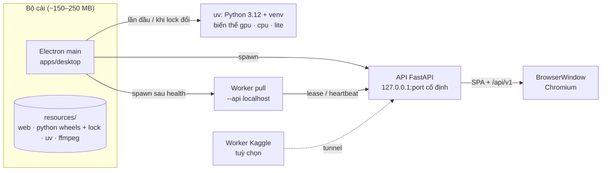

# ADR-011: Ứng dụng desktop = vỏ Electron + runtime Python do uv cài ở lần chạy đầu

**Status:** Proposed · **Date:** 2026-11-18 · **Deciders:** HABAO

## Context

Hiện tại muốn dùng Taber phải cài `uv`, Node/pnpm, FFmpeg, `just`, rồi mở hai terminal (`just app` và `just worker`).
Mục tiêu là một bộ cài bấm-là-chạy trên Windows, macOS và Linux, với hai ràng buộc:

1. **Giữ nguyên luồng hệ thống**: API FastAPI + SQLite phục vụ SPA, worker pull job qua HTTP (ADR-003, ADR-009, ADR-010).
   Worker Kaggle vẫn phải dùng được như cũ.
2. **Không sửa pipeline** (`packages/taber_ml`, `packages/taber_ir`).

Các yếu tố đã đo trên repo:

| Yếu tố | Số đo / sự thật | Hệ quả |
|---|---|---|
| Kích thước venv đầy đủ (Linux, CUDA) | 6,5 GB; riêng `nvidia/` 3,0 GB, `triton/` 1,0 GB, `torch/` 1,2 GB | Không thể nhét vào bộ cài |
| Giới hạn GitHub Releases | mỗi file ≤ 2 GiB | Bản đóng băng (PyInstaller) có CUDA vượt giới hạn |
| torch 2.15.0 trên PyPI | Linux: bản CUDA 13 (kéo theo ~4 GB `nvidia-*`, `cuda-*`, `triton`); Windows: **chỉ CPU**; macOS arm64: CPU; **macOS Intel: không có wheel** | Bản torch đúng phụ thuộc máy người dùng, phải chọn lúc cài trên chính máy đó |
| Wheel macOS trong lock | numpy, scipy, onnxruntime, torch: `macosx_14_0_arm64` | Bản macOS cần **macOS 14+, Apple Silicon** (`minimumSystemVersion`); chưa phát hành cho Intel Mac |
| torch CUDA cho Windows | `torch==2.15.0+cu132` chỉ có ở `download.pytorch.org/whl/cu132` | Bản GPU trên Windows lấy wheel từ chỉ mục PyTorch |
| torchaudio 2.11.1 | wheel `py3-none-<platform>`, không có biến thể CUDA | Chỉ cần đổi mỗi `torch` |
| SPA gọi API | URL tương đối `/api/v1`, FastAPI phục vụ cùng origin | Vỏ desktop chỉ cần mở `http://127.0.0.1:<port>/` |
| Cấu hình API/worker | mọi đường dẫn đi qua biến môi trường: `TABER_DATA_DIR`, `TABER_SPA_DIR`, `TABER_PORT`, `TABER_CACHE_DIR`, `--cache-dir`, `--token-file` | Đặt thư mục theo chuẩn từng hệ điều hành mà **không sửa code Python** |
| FFmpeg | API và worker gọi `ffmpeg`/`ffprobe` qua `PATH` | Đóng gói FFmpeg (bản LGPL) và đặt lên đầu `PATH` của tiến trình con |
| localStorage của SPA | `taber-theme`, kiểu thân đàn của hiệu chỉnh video | Origin gồm cả cổng: **cổng phải cố định giữa các lần mở** |
| Kiểm thử E2E | Playwright trên Chromium | Engine của vỏ nên là Chromium để giữ đúng những gì đã kiểm |

## Decision

Chọn **phương án A: vỏ Electron, runtime Python do `uv` dựng ở lần chạy đầu, theo biến thể phần cứng**.

Luồng giữ nguyên như `just app` + `just worker`; khác biệt duy nhất là ai khởi động tiến trình và thư mục nằm ở đâu.

### Biến thể runtime

| Biến thể | Nền tảng | torch | Tải về (ước tính) | Trên đĩa (đo trên Linux) | Khi nào |
|---|---|---|---|---|---|
| `gpu` | Windows x64, Linux x64 có NVIDIA | Windows: `+cu132` từ chỉ mục PyTorch; Linux: bản PyPI (CUDA 13) | ~3–4 GB | 6,5 GB | Có `nvidia-smi` (driver R580+ và compute capability 7.5+ cho CUDA 13: GTX 16 / RTX 20 trở lên) |
| `cpu` | Windows x64, Linux x64, macOS arm64 | Windows/macOS: bản PyPI; Linux: `+cpu`, bỏ chuỗi `nvidia-*`/`cuda-*`/`triton` | ~0,6 GB | 2,2 GB | Không có NVIDIA |
| `lite` | mọi nền tảng được phát hành | không có (pYIN, Basic Pitch ONNX, video MediaPipe) | ~0,3 GB | 1,2 GB | Máy yếu hoặc ít dung lượng |

Cả `lite` và `cpu` đã chạy smoke test thật trên Linux (dựng runtime → API → worker → upload → tab → xuất `.gp5`): lần lượt 36 s và 66 s khi cache uv đã có sẵn.

Danh sách gói xuất từ chính `uv.lock` (`uv export --frozen`, có hash), nên phiên bản trùng với môi trường dev. Dòng `torch`
được thay bằng URL wheel trực tiếp kèm `sha256` lấy từ chỉ mục PyTorch lúc build. Cài bằng `uv pip sync` (đúng tập gói, gỡ gói thừa khi cập nhật), rồi `uv pip check`.
Runtime chỉ dựng lại khi hash của lock đổi; các lần mở sau đi thẳng vào app.

**Mạng chậm hoặc chập chờn** (lần cài đầu có thể vượt 1 giờ trên đường quốc tế yếu):

- Wheel ghim bằng URL (torch `+cu132` trên Windows: một file 2,1 GB) do app tự tải (`runtime.ts`, `downloadResumable`): yêu cầu Range nối tiếp sau khi rớt mạng, sau 60 s không nhận byte nào, hoặc sau khi đóng app (lần mở sau tải tiếp từ file `.part`); kiểm `sha256` ở cuối. uv thì tải lại từ đầu khi rớt. Dòng `torch @ URL` được ghi thành `torch==2.15.0+cu132` + `--find-links cache/downloads`: uv cài từ file vừa tải, và khi file đã xoá (sau khi cài xong) thì bản đã cài vẫn thoả, nên cập nhật app không tải lại torch.
- uv chạy với `UV_HTTP_TIMEOUT=120`, `UV_HTTP_RETRIES=8`. Cỡ cache được đo không đồng bộ, không chặn cửa sổ.
- Các file model mà thư viện tự tải lúc dùng lần đầu (Demucs 55 MB, Beat This! 81 MB, MediaPipe 7,8 MB) được tải ngay lúc cài (`launch.py fetch-models`), có timeout, thử lại, tải nối, kiểm hash (`taber_ml/weights.py`). Không tải được thì vẫn cài xong; lần phân tích đầu tải lại, báo số MB trên màn hình job, và nếu vẫn hỏng thì chạy tiếp không có bước đó (giữ bản mix, beat tracker librosa, bỏ video) kèm cảnh báo, thay vì treo. Worker đặt `socket.setdefaulttimeout(120)` cho mọi thư viện tự tải mà không đặt timeout.
- `taber_ml/device.py` chạy một kernel thử trước khi dùng GPU: card mà bản torch không hỗ trợ (compute capability dưới mức của bản build) chạy trên CPU thay vì lỗi ở model đầu tiên.

### Thư mục theo hệ điều hành

| | Windows | macOS | Linux |
|---|---|---|---|
| Dữ liệu (`TABER_DATA_DIR`: db, uploads, analyses, `worker_token`) | `%LOCALAPPDATA%\HBA Guitar Taber\data` | `~/Library/Application Support/HBA Guitar Taber/data` | `$XDG_DATA_HOME/hba-guitar-taber/data` |
| Runtime (Python + venv) | `…\HBA Guitar Taber\runtime` | `…/HBA Guitar Taber/runtime` | `$XDG_DATA_HOME/hba-guitar-taber/runtime` |
| Cache (`TABER_CACHE_DIR`, `TORCH_HOME`, `HF_HOME`, uv cache, input cache của worker) | `…\HBA Guitar Taber\cache` | `~/Library/Caches/HBA Guitar Taber` | `$XDG_CACHE_HOME/hba-guitar-taber` |
| Log | `…\HBA Guitar Taber\logs` | `~/Library/Logs/HBA Guitar Taber` | `$XDG_STATE_HOME/hba-guitar-taber/logs` |

Windows dùng `LOCALAPPDATA` chứ không dùng `APPDATA` (roaming), vì runtime và video có thể lên vài GB. `TABER_DESKTOP_HOME` ghi đè tất cả (bản portable, CI).

### Vòng đời tiến trình

- **Một instance** (`requestSingleInstanceLock`): hai API cùng một SQLite và hai reaper là lỗi thật, không chỉ là bất tiện.
- **Cổng cố định**: lần đầu chọn một cổng trống rồi lưu vào `settings.json`; chỉ đổi khi cổng bị chiếm (localStorage gắn với origin).
- **Tiến trình con chết theo cha**: `apps/desktop/python/launch.py` (của vỏ, không thuộc pipeline) chạy `app.main:run` hoặc
  `taber_ml.cli worker` và có một luồng canh tiến trình cha (`getppid` trên POSIX, `WaitForSingleObject` trên Windows). Electron có crash thì API và worker cũng tự thoát, không giữ cổng và file SQLite.
- **Tắt**: worker trước, API sau; POSIX gửi `SIGTERM` rồi `SIGKILL` sau 5 s, Windows dùng `taskkill /T /F`. An toàn vì SQLite ở chế độ WAL, file được ghi kiểu ghi-tạm-rồi-đổi-tên, và job dang dở được reaper trả lại hàng đợi (ADR-003).
- **Worker tự khởi động lại** khi chết (2 s, 5 s, 15 s…), ngừng sau 5 lần trong 5 phút và báo lỗi kèm đường dẫn log.

### Bảo mật

- API chỉ nghe trên `127.0.0.1`. Token worker vẫn sinh vào `data/worker_token` như cũ.
- `BrowserWindow`: `contextIsolation`, `sandbox`, không `nodeIntegration`. Preload đưa cho trang cài đặt (file://) luồng cài, và cho trang app (`http://127.0.0.1:<cổng>`) đúng các lệnh của menu Engine cũ (`window.taberDesktop`: khởi động lại / đổi engine, bật tắt worker, mở thư mục log / dữ liệu, kiểm tra bản mới, đóng thông báo bản mới, bật tắt tự kiểm bản mới, chọn ngôn ngữ, xuất gói chẩn đoán, xem dung lượng và xoá engine / toàn bộ dữ liệu). Main process kiểm lại URL của frame gửi ở mỗi lệnh; không lệnh nào nhận đường dẫn hay URL từ trang. Điều hướng ra ngoài origin cục bộ bị chặn và mở bằng trình duyệt hệ thống.
- **Không thanh menu trên Windows/Linux**: các lệnh nằm trong bảng Engine của app (bấm đèn worker trên thanh trên cùng); phím tắt cũ vẫn còn (F5/Ctrl+R, F12/Ctrl+Shift+I, Ctrl+±/0, F11). macOS giữ menu hệ thống (Cmd+Q, copy/paste cần nó).
- Chống DNS rebinding: API nhận thêm `TABER_TRUSTED_HOSTS` (mặc định tắt, giữ nguyên hành vi cũ); bản desktop đặt `127.0.0.1,localhost`.
  Nếu không có lớp này, một trang web bất kỳ đang mở trong trình duyệt có thể đọc và sửa tab qua cổng cục bộ khi app đang chạy.

## Options Considered

### Option A: Electron + runtime do uv dựng lúc chạy đầu (chọn)

| Dimension | Assessment |
|---|---|
| Complexity | TB: ~1.400 dòng TypeScript, không có dependency npm lúc chạy |
| Cost | Miễn phí; bộ cài ~150–250 MB/nền tảng (Electron ~100 MB, FFmpeg ~60–75 MB, uv ~35 MB, wheel dự án 7 MB) |
| Scalability | Đổi lock thì runtime tự đồng bộ; thêm biến thể (vd ROCm) chỉ là thêm một tệp requirements |
| Team familiarity | Cao: TypeScript + Python, cùng stack đang có |

**Pros:** cùng engine Chromium với test Playwright (âm thanh m4a/AAC, Web Audio của alphaTab, EventSource chạy như đã kiểm); torch đúng phần cứng; bộ cài nhỏ, không đụng giới hạn 2 GiB; phiên bản Python khớp `uv.lock`.
**Cons:** lần đầu cần Internet và tải 0,3–4 GB; Electron tốn thêm ~100 MB và RAM so với webview hệ thống; cần ký mã để tránh cảnh báo SmartScreen/Gatekeeper.

### Option B: Tauri v2 + cùng runtime

| Dimension | Assessment |
|---|---|
| Complexity | TB–cao: phần vỏ viết bằng Rust |
| Cost | Bộ cài nhỏ hơn A ~90 MB |
| Scalability | Như A |
| Team familiarity | Thấp: chưa có Rust trong dự án |

**Pros:** vỏ ~10 MB, ít RAM.
**Cons:** dùng webview hệ thống (WebView2 / WKWebView / WebKitGTK), không phải engine đã test. Trên Linux, phát m4a/AAC (stem guitar/backing) phụ thuộc plugin GStreamer có hay không trên máy người dùng. Tiết kiệm 90 MB không đáng kể so với runtime 0,3–4 GB.

### Option C: đóng băng toàn bộ Python (PyInstaller/Briefcase) vào bộ cài

| Dimension | Assessment |
|---|---|
| Complexity | Cao: torch/mediapipe/numba cần hook riêng cho từng nền tảng |
| Cost | Bản GPU ~3–4 GB vượt giới hạn 2 GiB của GitHub Releases |
| Scalability | Mỗi lần bump thư viện phải build lại toàn bộ cho 3 OS × 3 biến thể |
| Team familiarity | TB |

**Pros:** chạy offline ngay từ đầu.
**Cons:** không phát hành được bản GPU qua GitHub; phải có tới 9 bộ cài; Linux bản CPU vẫn kéo 4 GB CUDA nếu không tách biến thể.

### Option D: không có vỏ, launcher + trình duyệt hệ thống

| Dimension | Assessment |
|---|---|
| Complexity | Thấp |
| Cost | Nhỏ nhất |
| Scalability | Như A |
| Team familiarity | Cao |

**Pros:** đơn giản nhất.
**Cons:** không phải "ứng dụng" (không cửa sổ riêng, không menu, không kiểm soát vòng đời tiến trình con khi người dùng đóng tab); engine trình duyệt tuỳ máy.

## Trade-off Analysis

Câu hỏi quyết định là **torch nào cho máy nào**. Ba hệ điều hành có ba cách phân phối torch khác nhau, và macOS Intel thì không có torch. Chỉ có cách dựng runtime ngay trên máy người dùng mới vừa chọn đúng bản, vừa không vượt giới hạn phát hành. Từ đó C bị loại.
Giữa A và B, phần vỏ chỉ chiếm 2–5% tổng dung lượng, trong khi rủi ro lớn nhất là phát lại âm thanh và video trên một engine chưa được test. A giữ đúng engine mà 14 test Playwright đang chạy, và không thêm ngôn ngữ mới vào dự án.

## Consequences

- **Dễ hơn:** người dùng cài một file rồi bấm chạy; worker local tự chạy cùng app; dữ liệu nằm đúng chỗ của từng hệ điều hành; nâng cấp lock thì runtime tự đồng bộ.
- **Khó hơn:** lần chạy đầu cần Internet. Phát hành phải build trên 3 runner. Trên macOS, pipeline chỉ kiểm tra CUDA nên Apple Silicon chạy torch trên CPU (không dùng MPS), vì không được sửa pipeline.
- **Cần xem lại:**
  - Ký mã: Windows (Azure Trusted Signing hoặc chứng thư OV), macOS (Apple Developer ID + notarize). Chưa ký thì trang tải phải hướng dẫn "More info → Run anyway" / "Open Anyway".
  - Giấy phép: phát hành công khai tức là bước sang giai đoạn public của ADR-008. Cần rà các mục `review` (PESTO, PyGuitarPro, soxr là LGPL, được cài nguyên bản từ PyPI; alphaTab là MPL-2.0), FFmpeg LGPL (kèm thông báo và link mã nguồn), dữ liệu huấn luyện của Beat This!. Cần thêm điều khoản cho phép người dùng chạy bản build trong `LICENSE`.
  - Khi bump torch: cập nhật thẻ CUDA trong `apps/desktop/runtime.config.json`. Bước stage sẽ dừng build nếu chỉ mục PyTorch không có wheel tương ứng.

## Action Items

1. [x] `apps/desktop`: vỏ Electron (single instance, cổng cố định, chặn điều hướng, menu, kiểm tra bản mới).
2. [x] Dựng runtime bằng uv theo biến thể `gpu`/`cpu`/`lite`, có màn hình cài lần đầu và đồng bộ khi lock đổi.
3. [x] `launch.py`: tiến trình con thoát theo tiến trình cha.
4. [x] `TABER_TRUSTED_HOSTS` (opt-in) trong API + test.
5. [x] Script stage: wheel dự án + requirements theo biến thể + uv + FFmpeg LGPL.
6. [x] Smoke test chạy thật (upload → worker → tab) trên cả 3 OS trong CI.
7. [ ] Ký mã Windows/macOS.
8. [ ] Rà giấy phép cho bản phát hành công khai (ADR-008) và bổ sung EULA.
9. [ ] Đo thời gian cài lần đầu trên Windows có NVIDIA thật (CI không có GPU).
